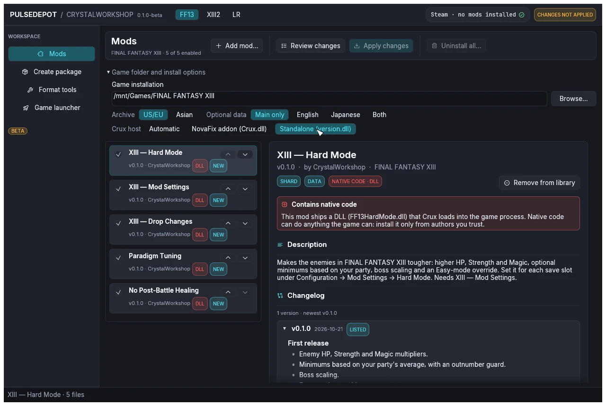

import { Tabs, TabItem } from '@astrojs/starlight/components';

PulseDepot's **Crux host** option (under **Game folder and install options**) decides which build it installs:

| Choice | What PulseDepot installs |
|---|---|
| **Automatic** (default) | The NovaFix addon when NovaFix is installed (`d3d9.dll` and `NovaFix.ini` beside the game executable), otherwise the standalone `version.dll`. |
| **NovaFix addon (Crux.dll)** | Always the addon, in NovaFix's `addons` folder. |
| **Standalone (version.dll)** | Always the standalone build, beside the game executable. |



The `d3d9.dll` in the game folder belongs to NovaFix. PulseDepot never ships or changes it.

## Per platform

<Tabs syncKey="os">
<TabItem label="Windows">

Either build works without extra steps. If another tool, such as an ASI loader, already owns `version.dll`, PulseDepot refuses to replace it: remove that file yourself, or choose **NovaFix addon (Crux.dll)**.

</TabItem>
<TabItem label="Linux">

- **Standalone:** Proton uses Wine's own `version.dll` unless you tell it otherwise. Set the game's Steam launch options once:

  ```
  WINEDLLOVERRIDES="version=n,b" %command%
  ```

  Without this override Crux never loads.
- **NovaFix addon:** keep whatever NovaFix itself needs. Crux adds no requirement.

</TabItem>
</Tabs>
