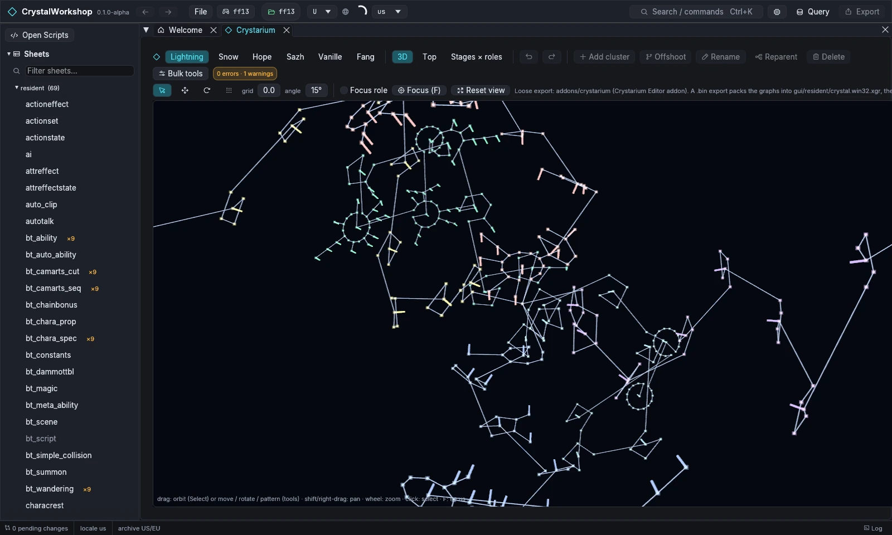
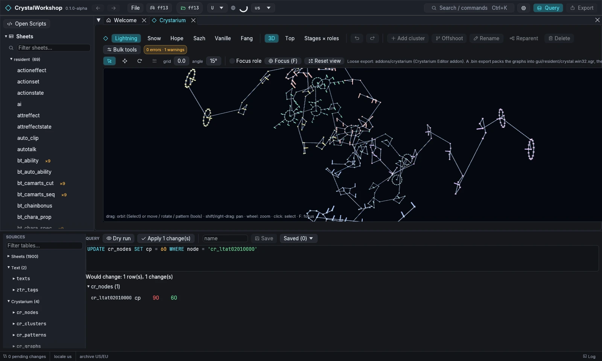

import { Tabs, TabItem, Steps, Aside, Badge, LinkCard, CardGrid } from '@astrojs/starlight/components';

{/* Generated by scripts/generate.mjs from the release docs. Edit the source, then run npm run generate. */}


**Goal:** change Crystarium nodes in FINAL FANTASY XIII: their CP cost and
bonus value, in the 3D editor and with SQL.

## Prerequisites

- FINAL FANTASY XIII open ([First Run and Game Setup](../first-run/)). The Crystarium
  editor is **XIII only**. XIII-2 and LR hide it.

## Steps: in the editor

<Steps>

1. Open **Crystarium** in the navigator, or choose **Open the Crystarium**
   on the Welcome page.
2. **Toolbar:**
   - pick a character: **Lightning**, **Snow**, **Hope**, **Sazh**,
     **Vanille** or **Fang**;
   - pick a view: **3D**, **Top**, or the **Stages × roles** table.
3. **Viewport:**
   - drag to orbit; shift- or right-drag to pan; scroll to zoom;
   - click a node to select it; **F** focuses it;
   - **Focus role** shows one role; **Reset view** resets the camera.
4. **Edit the graph:**
   - **Tools:** **Select**, **Move**, **Rotate** and **Pattern**, with
     **grid** and **angle** snapping;
   - **Structure:** **Add cluster**, **Offshoot**, **Rename**,
     **Reparent** and **Delete**;
   - **Bulk tools** changes many nodes at once;
   - **Undo** / **Redo** are in the toolbar.
5. **Check:** the validation badge (for example `0 errors · 1 warnings`)
   lists problems. Export is blocked until there are no errors.

</Steps>



## Steps: with SQL

The Crystarium is also four tables in the **Query** panel: `cr_nodes`,
`cr_clusters`, `cr_patterns` and `cr_graphs`. `cr_nodes` has these columns:
`node`, `character`, `stage`, `role`, `cluster`, `type` (`HP`, `MAG`,
`ABI`, …), `value`, `cp` and `ability`.

```sql
SELECT node, role, type, value, cp FROM cr_nodes WHERE character = 'lightning' AND stage = 2
UPDATE cr_nodes SET cp = 60 WHERE node = 'cr_ltat02010000'
```

**Dry run** previews the change, and **Apply N change(s)** stages it. Both
the editor and SQL changes are undoable.



## Result

The changed graphs are pending. On export:

- **Loose files** go to `addons/crystarium`, for the Crystarium Editor
  addon.
- **A shard** packs the graphs into `gui/resident/crystal.win32.xgr` and
  the matching data.

See [Simple Mod Export](../mod-export/).

## Undo / revert

**Undo** and **Redo** are in the Crystarium toolbar. On the **Changes**
page, revert the Crystarium files.

## Known limits

- XIII only.
- PulseDepot merges Crystarium changes from several mods. Its review shows a
  Crystarium section.

## Related

[Simple DB Edit](../db-edit/) · [Simple Mod Export](../mod-export/) · [Glossary](../glossary/)
