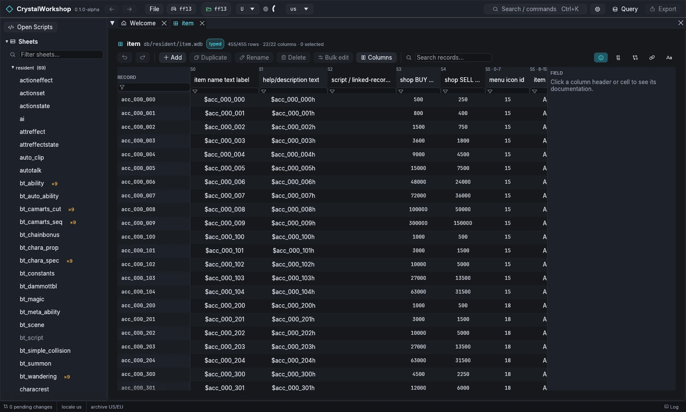
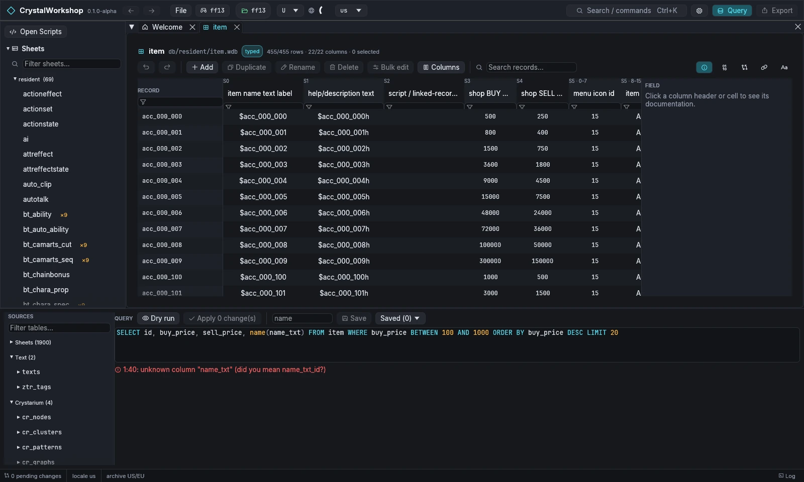
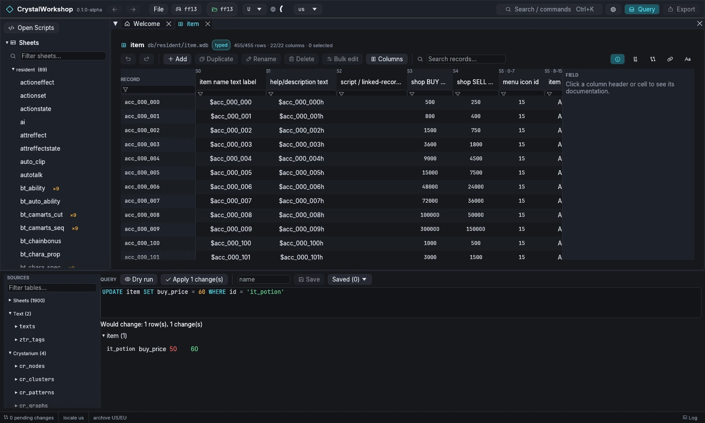

import { Tabs, TabItem, Steps, Aside, Badge, LinkCard, CardGrid } from '@astrojs/starlight/components';

{/* Generated by scripts/generate.mjs from the release docs. Edit the source, then run npm run generate. */}


**Goal:** change the shop price of a Potion in FINAL FANTASY XIII. First you
edit the sheet directly, then you make the same change with SQL.

## Prerequisites

- FINAL FANTASY XIII open ([First Run and Game Setup](../first-run/)). XIII-2 and LR
  work the same way through their record packs: open `wdbpack.bin` in the
  navigator, and the `item` sheet name works there too.

## Steps: in the sheet

<Steps>

1. In the navigator, open **Sheets › resident › item** (or `Ctrl+K`, then
   type `item`). The sheet header shows its path `db/resident/item.wdb`,
   the **typed** badge (its schema is known), and the row and column
   counts.
2. Type `it_potion` in **Search records…** to find the Potion row.
3. Click its **shop BUY** cell (column `buy_price`). Type a new value and
   press Enter. Click a column header or cell to read its documentation in
   the **FIELD** panel on the right.
4. The toolbar has **Undo** and **Redo** for the sheet, plus **Add**,
   **Duplicate**, **Rename**, **Delete**, **Bulk edit** and **Columns**.

</Steps>



## Steps: with SQL

<Steps>

1. Choose **Query** in the top bar. The panel lists every table under
   **SOURCES**: Sheets, Text, Crystarium and more.
2. Read data:

   ```sql
   SELECT id, buy_price, sell_price, name(name_txt)
   FROM item WHERE buy_price BETWEEN 100 AND 1000
   ORDER BY buy_price DESC LIMIT 20
   ```

   Choose **Dry run** to run it.

   

3. Change data:

   ```sql
   UPDATE item SET buy_price = 60 WHERE id = 'it_potion'
   ```

   **Dry run** shows each change as *row · column · old → new* and writes
   nothing.

   

4. Choose **Apply N change(s)**. The change becomes a pending edit, and the
   status bar shows `1 pending change`.
5. Optional: type a name and choose **Save** to keep the query. **Saved
   (N)** lists your saved queries, which are kept in
   `<game>/ff13_studio/queries.json`.

</Steps>

Other useful statements:

```sql
INSERT INTO item (id, buy_price) COPY FROM 'it_potion' VALUES ('it_mega', 900)
SELECT i.id, t.text FROM item i JOIN texts t ON t.key = i.name_txt AND t.locale = 'us'
```

## Result

The **Changes** page lists `db/resident/item.wdb`. **Export (1)** is now
active. Continue with [Simple Mod Export](../mod-export/).

## Undo / revert

- **Undo** in the sheet toolbar. An applied query is one undoable batch
  (MCP `undo` reverts it too).
- On the **Changes** page, revert a file to the game's original.
- Nothing reaches the game until you export.

## Known limits

- `!!strin7` string columns cannot be edited yet.
- A query script does not see rows that an `INSERT` earlier in the same
  script added.
- XIII-2 and LR exports are not verified in game. The export dialog marks
  them **Unverified**, and you must allow them per file.

## Related

[ZTR Text Edit](../ztr-text-edit/) · [Crystarium Edit](../crystarium-edit/) · [Simple Mod Export](../mod-export/) · [Glossary](../glossary/)
