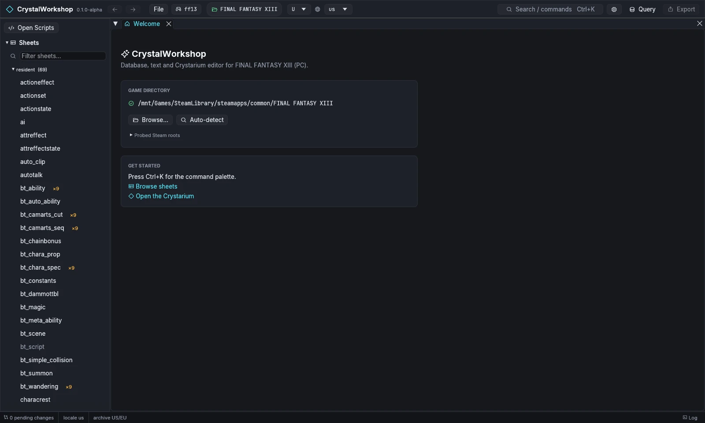

import { Steps } from '@astrojs/starlight/components';

In CrystalWorkshop, a mod project belongs to a game install: every edit you make is a **pending change** for that game, kept in CrystalWorkshop's work folder until you export it. Opening the game is all it takes to start one.

<Steps>

1. **Start CrystalWorkshop.** The **Welcome** page shows the game folder it found in your Steam libraries.

   

2. **If no folder was found**, choose **Browse…** and pick the folder that contains `white_data`. **Auto-detect** searches again.

3. **Check the game and archive** in the top bar: the game picker shows `ff13`, the archive variant **U** (US/EU) and the display locale, for example `us`. The status bar reads `0 pending changes`.

4. **Find your way around.** The navigator on the left lists Sheets, Text, Models, Motions, VFX, Sound, Scenes, Actions, Events, the Crystarium, Battle and Changes. **Search / commands** (`Ctrl+K`) opens any page or file by name. The **Project** page (`Ctrl+K`, then *Project*) holds your mod's metadata, native code units, attachments and filelists.

</Steps>

**Result:** your project is open, with nothing changed yet. CrystalWorkshop only reads the game; its own work goes to `ff13_studio/` in the game folder.

More detail: [First run and game setup](../../first-run/). Next: [2. Make an edit](../make-an-edit/).
