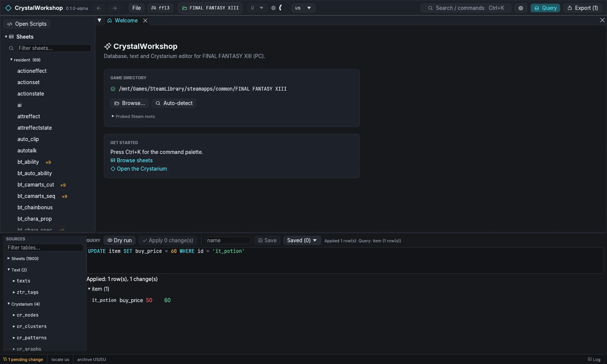

import { Steps, Tabs, TabItem } from '@astrojs/starlight/components';

Your first edit: the Potion's shop price. Both ways below make the same pending change; pick one.

<Tabs>
<TabItem label="In the sheet">

<Steps>

1. **Open the item sheet.** In the navigator choose **Sheets › resident › item**, or press `Ctrl+K` and type `item`. The header shows `db/resident/item.wdb` and the **typed** badge (its columns are known).

   

2. **Find the Potion.** Type `it_potion` in **Search records…**.

3. **Change the price.** Click its **shop BUY** cell (column `buy_price`), type `60` and press Enter. Click a column header to read its documentation in the **FIELD** panel.

4. **Undo** and **Redo** in the sheet toolbar take it back if you change your mind.

</Steps>

</TabItem>
<TabItem label="With SQL">

<Steps>

1. **Open the Query panel** with **Query** in the top bar. It lists every table under **SOURCES**: sheets, text, Crystarium and more.

2. **Type the change and dry-run it:**

   ```sql
   UPDATE item SET buy_price = 60 WHERE id = 'it_potion'
   ```

   **Dry run** shows each change as *row · column · old → new* and writes nothing.

   

3. **Apply it.** Choose **Apply 1 change(s)**. The change becomes a pending edit: the result reads `Applied: 1 row(s), 1 change(s)` and the status bar shows `1 pending change`.

   

</Steps>

</TabItem>
</Tabs>

**Result:** the status bar shows `1 pending change`, and **Export (1)** in the top bar is active. Nothing has reached the game yet.

More detail: [Sheets and SQL](../../db-edit/). Next: [3. Review your changes](../review-changes/).
