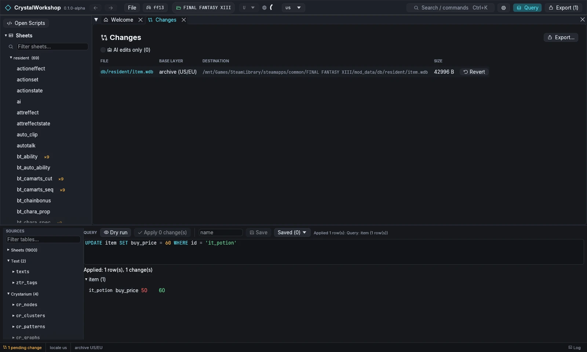

import { Steps } from '@astrojs/starlight/components';

<Steps>

1. **Open Changes**, in the navigator or through **Export (1)**. Each changed file is one row: the file, its **base layer** (the archive or an earlier mod layer), its destination and its size.

   

2. **Check that only what you meant is there.** For this mod that is one file, `db/resident/item.wdb`. **AI edits only** filters to changes made by AI clients, if you use [MCP](../../mcp/).

3. **Revert what you do not want.** **Revert** on a row puts that file back to the game's original. Exporting never changes the game archives, so there is nothing else to undo.

</Steps>

**Result:** you know exactly what your mod will change.

Next: [4. Export a .cws shard](../export-shard/).
