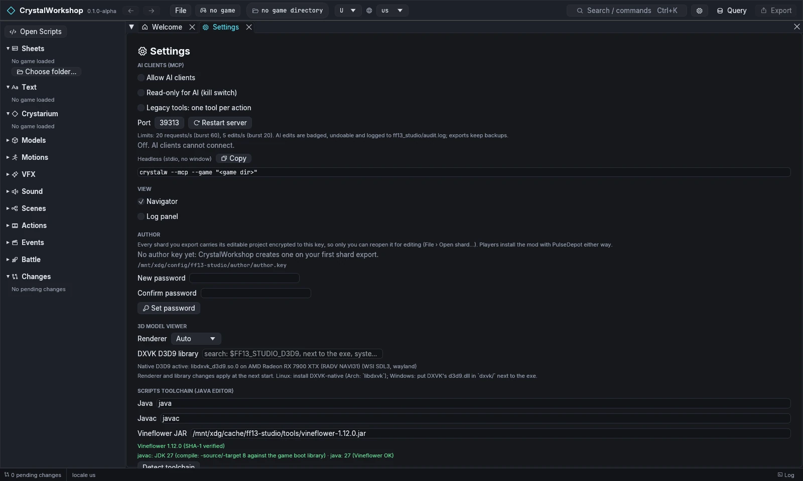

import { Tabs, TabItem, Steps, Aside, Badge, LinkCard, CardGrid } from '@astrojs/starlight/components';

{/* Generated by scripts/generate.mjs from the release docs. Edit the source, then run npm run generate. */}


**Goal:** let an AI client, such as Claude Code, Claude Desktop or Codex,
read and edit your game data through CrystalWorkshop, either in the open app
or headless with no window.

CrystalWorkshop serves the [Model Context Protocol](https://modelcontextprotocol.io).
AI clients use the same action layer as the UI. Their edits are ordinary
pending changes: you see them on the **Changes** page (**AI edits only**),
can undo them, and nothing reaches the game until an export.

## Prerequisites

- CrystalWorkshop and `crystalw` installed ([Installing](../installing/)), and a game
  install.
- An MCP client.

## Option A: headless, over stdio (`crystalw --mcp`)

`crystalw` runs the same server with no window. The protocol goes over
stdin/stdout, and logs go to stderr.

```sh
crystalw --mcp --game ff13                      # or xiii2, lr; detected install
crystalw --mcp --game ff13 --root "/path/to/FINAL FANTASY XIII"
crystalw --mcp --game lr --variant A --locale us --read-only
crystalw --version                              # crystalw 0.1.0-alpha (CrystalWorkshop ALPHA)
```

| Flag | Meaning |
|---|---|
| `--game ff13\|xiii2\|lr` | The game. A directory is also accepted, and taken as `--root`. |
| `--root <dir>` | The install folder. Default: the detected install. |
| `--variant U\|C\|A\|V` | The archive variant: U/C for XIII and XIII-2, A/V for LR. |
| `--locale <l>` | The display locale for names (default `us`). |
| `--read-only` | AI clients can only read. |
| `--tools progressive\|full` | Tool listing mode (below). `--full-tools` is the same as `--tools full`. |
| `--loose <dir>` | Read loose files instead of the archives. |

**Claude Code:**

```sh
claude mcp add crystalworkshop -- crystalw --mcp --game ff13
```

or in a project `.mcp.json`:

```json
{
  "mcpServers": {
    "crystalworkshop": {
      "command": "crystalw",
      "args": ["--mcp", "--game", "ff13"]
    }
  }
}
```

**Claude Desktop** (`claude_desktop_config.json`, opened from
Settings › Developer › Edit Config). Use the full path to `crystalw`:

```json
{
  "mcpServers": {
    "crystalworkshop": {
      "command": "C:\\Tools\\CrystalWorkshop\\crystalw.exe",
      "args": ["--mcp", "--game", "ff13"]
    }
  }
}
```

**Codex** (`~/.codex/config.toml`):

```toml
[mcp_servers.crystalworkshop]
command = "crystalw"
args = ["--mcp", "--game", "ff13"]
```

## Option B: the open app, over HTTP

1. Open **Settings** (the gear button, or `Ctrl+K` › *Open Settings*) ›
   **AI clients (MCP)**.
2. Tick **Allow AI clients**. The server listens on
   `http://127.0.0.1:39313/mcp`; change the port and choose **Restart
   server** if you need to. The page shows a random **bearer token**.
   **Regenerate** replaces it, and clients then need the new one.
3. Copy a ready-made snippet from the page. They cover Claude Code (command
   and `.mcp.json`), Codex and the headless form. For example:

   ```sh
   claude mcp add --transport http crystalworkshop http://127.0.0.1:39313/mcp \
     --header "Authorization: Bearer <token>"
   ```

4. **Read-only for AI (kill switch)** keeps clients reading while every
   edit and export fails.



## Progressive tool discovery

By default (`progressive`), the server lists a small **core set of 17
tools**:

- **The lean tools:** `query`, `status`, `undo`, `export`, `script`,
  `model`, `scene`, `vfx`, `acb`.
- **The game tools:** `detect_game_installs`, `get_active_game`,
  `switch_game`.
- **Five discovery tools:**

  | Tool | Does |
  |---|---|
  | `list_tool_groups` | Lists the domain groups (`game`, `query`, `sheets`, `texts`, `links`, `crystarium`, `changes`, `scripts`, `assets`, …). |
  | `search_tools` | Finds a tool by words in its name, group or description. |
  | `describe_tool` | Returns a tool's full description and input schema. |
  | `enable_tool_group` | Adds a group's tools to the list and notifies the client (`tools/list_changed`). |
  | `call_tool` | Runs any tool, listed or not. |

The full catalog (70 tools) stays reachable without filling the model's
context. `--tools full`, `FF13_MCP_TOOLS=full` or **Settings › Legacy
tools** lists everything at once instead.

A short session (real output, XIII):

```text
status
  → …/FINAL FANTASY XIII · U · us · 0 pending (0 AI)
query {"sql":"SELECT id, buy_price FROM item WHERE id = 'it_potion'"}
  → id  buy_price
    it_potion  50
query {"sql":"UPDATE item SET buy_price = 60 WHERE id = 'it_potion'"}
  → dry-run 1 row(s), 1 change(s); dry_run=false applies
    table  row  column  old  new
    item  it_potion  buy_price  50  60
search_tools {"query":"text","limit":5}
  → list_texts, read_text, set_text, add_text_entry, delete_text_entry (group texts, not listed yet; 22 matches)
enable_tool_group {"group":"texts"}    → the texts tools are listed from now on
```

## What the AI can and cannot do

**Can:**

- Read everything the UI reads: sheets, text, scripts, models, VFX, scenes,
  actions, links.
- Run SQL (writes are previewed by default; `dry_run:false` applies them).
- Edit through the same editors: fields, text, scripts (compile), scene
  placements, VFX fields.
- Render models and scenes to PNG.
- Export loose files or a `.cws` shard.

**Cannot:**

- Write save files, or install mods into the game. PulseDepot does that, and
  only when you apply.
- Bypass **Read-only for AI**, or `--read-only`.
- Unlock a password-protected author key. Reopening your own shards needs
  you, in the app.
- Do things the UI refuses. The same guards apply, for example unverified
  XIII-2/LR export routes need explicit consent (`allow_unverified`).

Every AI action is recorded in `<game>/ff13_studio/audit.log`. Edits stay
pending until exported, and `undo` reverts them.

## Undo / revert

- Use `undo` (MCP), or the editors' **Undo** and the **Changes** page
  (filter **AI edits only**).
- Untick **Allow AI clients** to stop the server.

## Related

[Simple DB Edit](../db-edit/) · [Simple Mod Export](../mod-export/) · [FAQ and Troubleshooting](../faq/)
