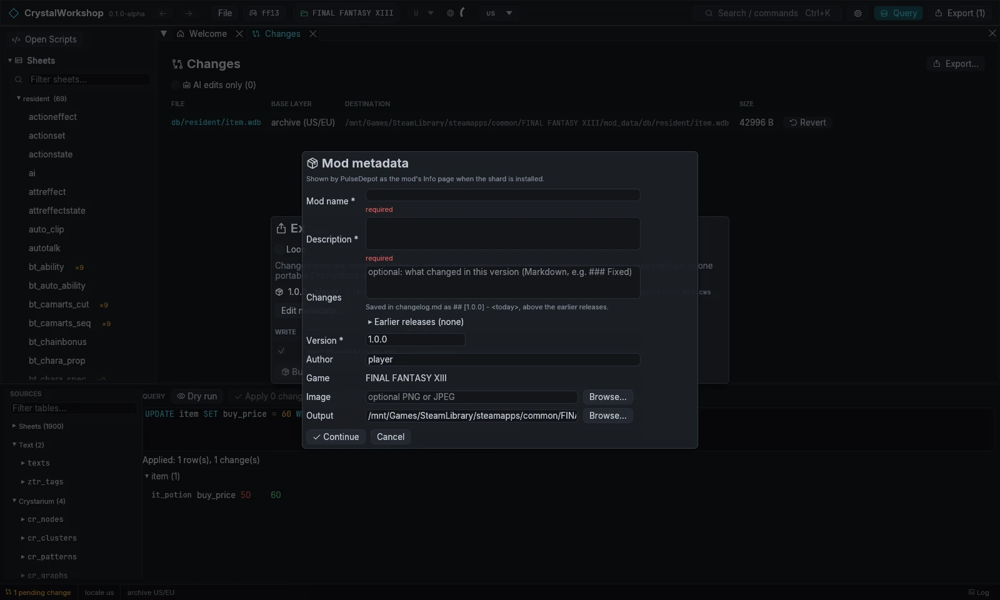

import { Tabs, TabItem, Steps, Aside, Badge, LinkCard, CardGrid } from '@astrojs/starlight/components';

{/* Generated by scripts/generate.mjs from the release docs. Edit the source, then run npm run generate. */}

**Goal:** turn your pending changes into a **CrystalWorkshop Shard** (`.cws`),
then install it with PulseDepot and try it in game.

## Prerequisites

- At least one pending change. For example, the Potion price from
  [Simple DB Edit](../db-edit/). The status bar shows `1 pending change`, and the top
  bar shows **Export (1)**.
- PulseDepot 0.1.0-beta (its own package), to install the shard.

## Steps: review your changes

<Steps>

1. Open **Changes**: in the navigator, or with **Export (N) ›** the Changes
   page. It lists each changed file, its base layer (the archive or an
   earlier mod layer), its destination and its size. **AI edits only**
   filters to changes made by AI clients.

   

2. The **Project** page (`Ctrl+K` › *Project*) shows the shard project:
   - metadata;
   - native code units;
   - attachments;
   - filelists.

</Steps>

## Steps: build the shard

<Steps>

1. Choose **Export…**. The **Export changes** dialog plans what will be
   written. It never writes until you confirm.
2. Choose **Shard (.cws)**. The changed files are stored as patches against
   the original game files, and staged scripts as Java patches. The other
   choice, **Loose files (mod_data)**, writes the files straight into the
   game's `mod_data` instead.
3. The **Mod metadata** form opens the first time. **Edit metadata…**
   reopens it.
   - **Mod name** and **Description** are required.
   - **Changes** is this version's changelog entry, in Markdown such as
     `### Changed` and a list.
   - **Version** is required and must be semver, for example `1.0.0`.
   - **Author**, **Game** (read-only) and an optional **Image** are shown
     on PulseDepot's details page.
   - **Output** defaults to `<game>/ff13_studio/exports/<name>.cws`.

   

4. Rows marked **Unverified** are routes that are not proven in game (all of
   XIII-2 and LR). Tick **allow** on each one to include it. **Not exported
   (N)** lists edits that cannot be shipped and the reason.
5. Choose **Build shard (N files)**. CrystalWorkshop builds the shard,
   verifies it and writes it. Your changes stay pending, so you can keep
   working and export again.

</Steps>

### Your author key

The first shard export silently creates your **author key** in
`~/.config/ff13-studio/author/` (the XDG config folder; on Windows, the
matching app-data folder). Each shard carries your project encrypted to this
key. Only you can reopen it as an editable project with **File › Open
shard…**. Players need no key.

**Settings › Author** shows the key id and can protect it with a password.
**Back up this folder.** Without the key you cannot reopen your own shards
as projects. The installable mod inside each shard keeps working.

## Steps: install with PulseDepot

<Steps>

1. Start PulseDepot, choose the same game tab, and choose **Add mod…**. Pick
   the `.cws` (or drop it on the window).
2. Choose **Review changes**, then **Apply changes** with the game closed.
   PulseDepot installs Crux if needed and writes `active.crximg`.
3. Start the game. On Linux/Proton without NovaFix, the launch options must
   contain `WINEDLLOVERRIDES="version=n,b" %command%`.

</Steps>

See the [PulseDepot guide](../../pulsedepot/) for ordering,
conflicts and troubleshooting.

## Result

The shard is in `ff13_studio/exports/`, and PulseDepot lists it as
**SHARD · v1.0.0**. In game, the Potion's shop price is the new value.

## Undo / revert

- **In CrystalWorkshop:** revert files on the **Changes** page. Exporting
  never changes the game archives.
- **In PulseDepot:** untick the mod, or choose **Uninstall all…**, then
  **Apply changes**. Your saves are never touched.
- **To update a mod:** export again with a higher **Version**. PulseDepot
  replaces the listed mod and shows the changelog.

## Related

[Simple DB Edit](../db-edit/) · [FAQ and Troubleshooting](../faq/) · [Glossary](../glossary/) · [Enabling MCP](../mcp/)
