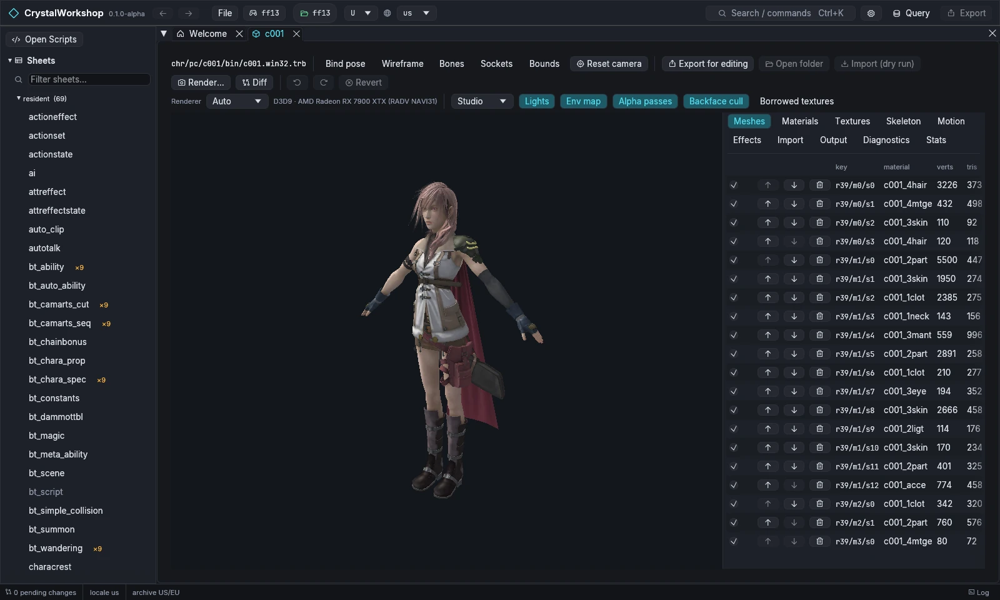

import { Tabs, TabItem, Steps, Aside, Badge, LinkCard, CardGrid } from '@astrojs/starlight/components';

{/* Generated by scripts/generate.mjs from the release docs. Edit the source, then run npm run generate. */}

**Goal:** inspect a character model (Lightning, `c001`): its meshes,
materials and textures. Then render it, and edit it through a glTF
workspace.

## Prerequisites

- A game open ([First Run and Game Setup](../first-run/)).
- DXVK and a GPU driver with Vulkan 1.3 support for the game-shader preview
  ([Installing](../installing/)). Without them, the **Fallback (wgpu)** renderer draws an
  approximation.
- For editing: a 3D tool that can round-trip glTF (`.glb`), such as
  Blender, and an image editor.

## Steps: inspect

<Steps>

1. Open **Models** in the navigator and pick `chr/pc/c001/bin/c001.win32.trb`
   (`Ctrl+K`, then type `c001`).
2. The viewport draws the model with the game's own shaders when
   **Renderer** is **Auto** or **D3D9 (game shaders)**. The status next to
   it names the device.
   - **Toggles:** **Lights**, **Env map**, **Alpha passes**, **Backface
     cull**, **Borrowed textures**.
   - **Views:** **Bind pose**, **Wireframe**, **Bones**, **Sockets**,
     **Bounds**.
   - **Studio** chooses the light preset.
3. The right column has these panels:

   | Panel | Shows |
   |---|---|
   | **Meshes** | Each mesh with its material, vertex and triangle counts. Hide, reorder (↑ ↓) or delete meshes. |
   | **Materials** | Shader parameters (PRAM). |
   | **Textures** | Each texture, to view or replace. |
   | **Skeleton** | Joints. |
   | **Motion** | Play clips from the model's motion packs. |
   | **Effects** | VFX attached to the model. |
   | **Import** | The import report (see below). |
   | **Output** | The model's files. |
   | **Diagnostics** | Problems found reading the model. |
   | **Stats** | Counts and sizes. |

4. **Render…** writes a PNG. **Diff** compares your edit with the original.

</Steps>

## Steps: edit through glTF

<Steps>

1. Choose **Export for editing**. CrystalWorkshop writes a workspace to
   `<game>/ff13_studio/workspace/models/<game>/<archive path>/`. **Open
   folder** opens it. The workspace holds:

   | File | Edit it? |
   |---|---|
   | `model.glb` | Yes |
   | `textures/*.png` | Yes |
   | `model.ff13.json` | No (the sidecar) |
   | `model.obj` | No (inspection only) |
   | `manifest.json` | No |

2. Edit `model.glb`:
   - **You can change:** vertex positions, normals, UVs, colours and skin
     weights (with the same counts); material parameters in
     `extras.ff13.params`; joint rest poses; sockets.
   - **You can also** delete or reorder primitives (meshes), and edit a
     texture PNG at the same size.
   - **Keep** the `_FF13_VID` attribute and `extras.ff13.key` when your
     exporter allows it.
3. Choose **Import (dry run)**. The report rates the import:
   - **Tier A:** the change patches the existing model safely, and
     **Apply** stages it.
   - **Tier B:** adding vertices, triangles, materials or bones is not
     applied yet.
   - **Rejected:** for example, a stale workspace from before another
     edit. Export again.
4. Choose **Apply**. The model becomes a pending change.

</Steps>

## Result

The **Changes** page lists the model's `.trb` and `.imgb`. Export them with
[Simple Mod Export](../mod-export/).

## Undo / revert

**Undo**, **Redo** and **Revert** are in the model toolbar. Revert returns
the model to the game's original. The workspace folder stays until you
delete it.

## Known limits (Experimental)

- Model writes for XIII-2 and LR are **not verified** in game.
- XIII-2 and LR background blocks borrow textures from other blocks, and the
  preview shows them as borrowed.
- Only Tier A imports apply. Tier B changes are reported but not written.
- New motion packs are XIII only.

## Related

[VFX Edit](../vfx-edit/) · [Scene Edit](../scene-edit/) · [Simple Mod Export](../mod-export/) · [Glossary](../glossary/)
