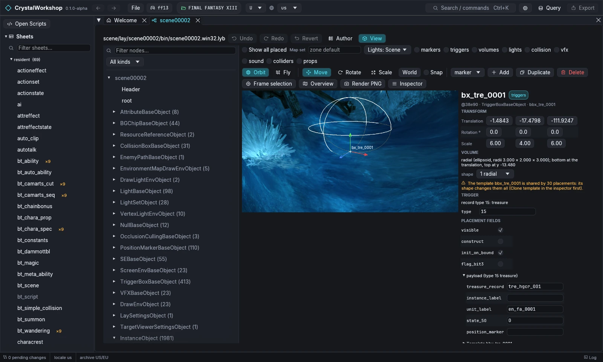
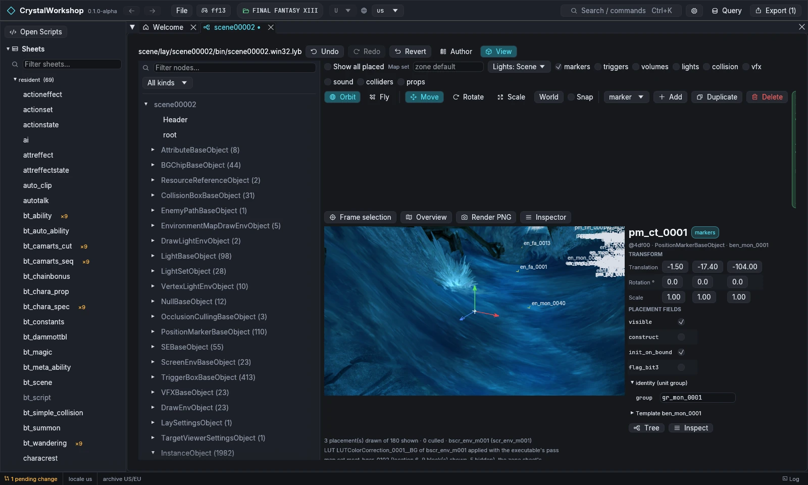
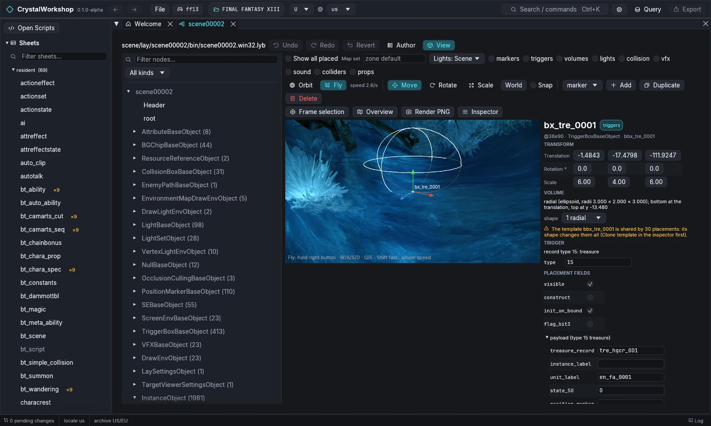
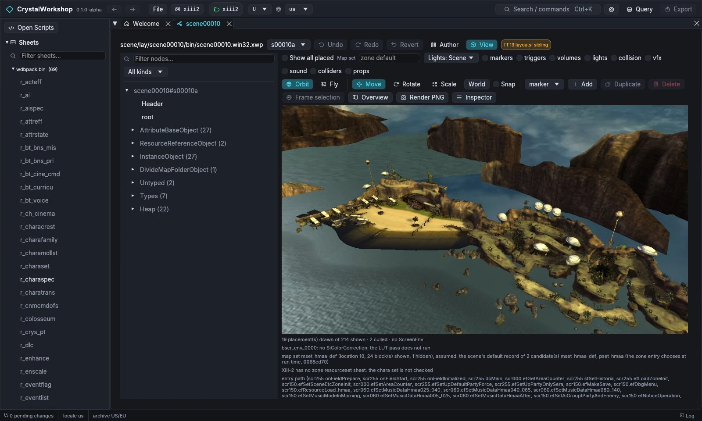
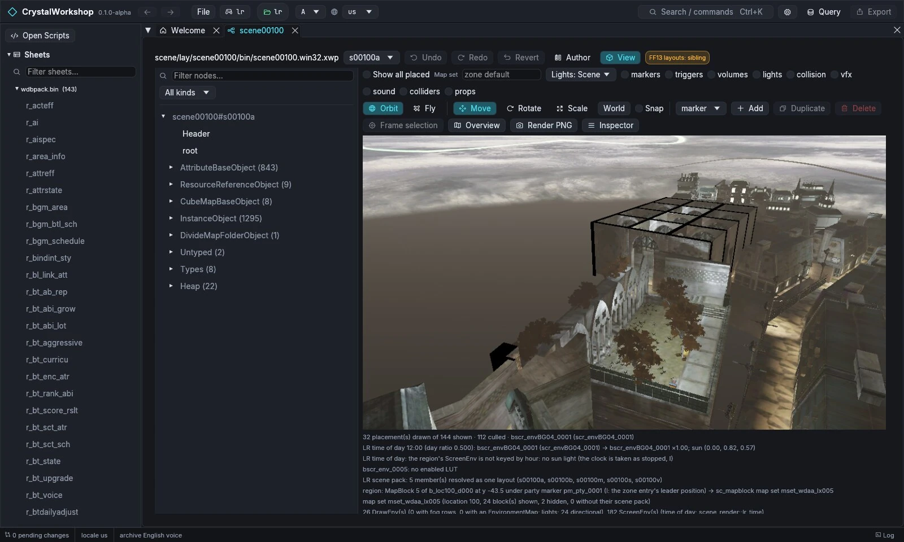

import { Tabs, TabItem, Steps, Aside, Badge, LinkCard, CardGrid } from '@astrojs/starlight/components';

{/* Generated by scripts/generate.mjs from the release docs. Edit the source, then run npm run generate. */}

**Goal:** open a zone layout (LYB) in the scene editor. Then fly around,
select a placement, move it with the gizmo, edit its fields, and add,
duplicate or delete placements.

## Prerequisites

- A game open ([First Run and Game Setup](../first-run/)). The scene editor is complete
  for XIII and **Experimental** for XIII-2 and LR.
- DXVK and a GPU driver with Vulkan 1.3 support. The scene View renders
  with the game's shaders and has no fallback renderer ([Installing](../installing/)).

## Background

A zone's layout is an **LYB** file:

- **XIII:** `scene/lay/sceneNNNNN/bin/sceneNNNNN.win32.lyb`.
- **XIII-2 and LR:** an `.xwp` pack of member layouts, such as
  `s00010a`. Pick the member next to the path.

It places background chips, characters, treasure and triggers, lights,
sounds, VFX, markers and colliders.

## Steps

<Steps>

1. Open **Scenes** in the navigator and pick a scene. This example uses
   XIII `scene00002` (`Ctrl+K`, then type `scene00002`).
2. The tab has two modes:
   - **Author:** the node tree and fields;
   - **View:** the 3D editor.

   Choose **View**. The scene is staged as the game loads it at zone start.
   **Show all placed** draws every placement. **Map set** picks another map
   set.
3. **Camera:**
   - **Orbit** (the default): drag to orbit, scroll to zoom.
   - **Fly:** free flight.
   - **Frame selection** zooms to the selected placement.
   - **Overview** shows the whole scene from above.
4. **Select:** click a placement in the viewport, or a node in the tree on
   the left (**Filter nodes…** and **All kinds** narrow the tree). The
   **Inspector** on the right shows:
   - the placement's transform;
   - its volume or shape;
   - its trigger or record type;
   - **PLACEMENT FIELDS**;
   - the typed payload, for example a treasure's `treasure_record`.

   

5. **Move, rotate, scale:**
   - pick **Move**, **Rotate** or **Scale** (keys **G**, **R**, **S**);
   - lock an axis with **X**, **Y** or **Z**;
   - toggle **World** / local with **L**;
   - turn **Snap** on to snap.

   Or type values in the Inspector's Translation, Rotation and Scale boxes.
   A warning says when a shape template is shared by other placements:
   **clone the template** first to change only this one.
6. **Fields:** edit any value in **PLACEMENT FIELDS** or the payload. Each
   edit is a pending change.
7. **Add:** choose a kind in the combo (marker, trigger, chip, screen_env,
   light, vfx, sound, collider, jump, menu, mission, placement), then
   **Add**. The new placement is selected. **Duplicate** copies the
   selection. **Delete** asks for confirmation.

   

   

8. **Overlays:** **markers**, **triggers**, **volumes**, **lights**,
   **collision**, **vfx**, **sound**, **colliders** and **props** draw
   helpers. **Lights: Scene / Studio / Off** picks the lighting.
9. **Render PNG** writes the current view to
   `<game>/ff13_studio/workspace/renders/`.

</Steps>

### Open a mod project's changed zones

Import a shard or a mod project into the session:

- **GUI:** **File › Open shard…**, then **Import as project**, picks a
  `.cws`.
- **Folder:** a mod project directory can only be imported through MCP
  `import_bin` with the folder path ([Enabling MCP](../mcp/)).

The imported scene edits are pending changes. Turn on **Modified only** in
the Scenes tree to see the zones they touch, then open one in **View**.

### XIII-2 and LR

The same editor works on `.xwp` members. The **FF13 layouts: sibling**
badge means that a type's meaning is assumed to match XIII and is not yet
verified for this game.

**LR time of day.** The View page renders LR scenes at noon, and the status
lines under the viewport show the hour and the ScreenEnv used. Other hours
are available only through MCP: `scene op=render view={"lights":"scene@18"}`.
They change the image only in regions whose ScreenEnvs are keyed by hour.
In the Luxerion layout below, the region is not keyed by hour, so every hour
looks the same.

## Result

Edited layouts show as changed. The **Changes** page lists the `.lyb` /
`.xwp`. Export them with [Simple Mod Export](../mod-export/).

## Undo / revert

**Undo**, **Redo** and **Revert** are in the scene toolbar. Revert returns
the layout to the game's original.

## Known limits (Experimental)

- **Rendering:**
  - XIII-2 and LR layouts and renders are Experimental.
  - XIII-2 weather is the layout's default; the UI has no weather selector.
  - LR time of day is MCP-only, and its per-hour region tables are not
    traced yet.
  - The View page lists what it does not reproduce. Examples include
    shadows, and glare and colour-correction formulas.
- **Tools:** the zone tool has no GUI page (MCP only).

## Related

[VFX Edit](../vfx-edit/) · [Model Edit](../model-edit/) · [Simple Mod Export](../mod-export/) · [Glossary](../glossary/)
