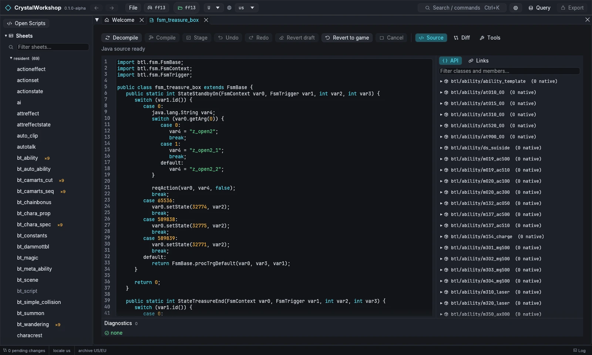
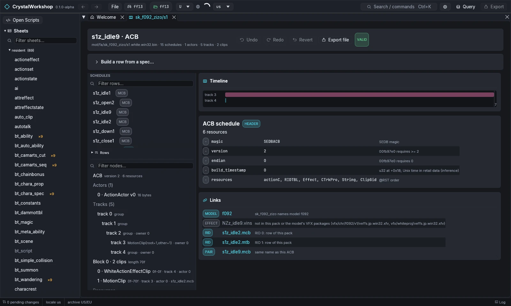
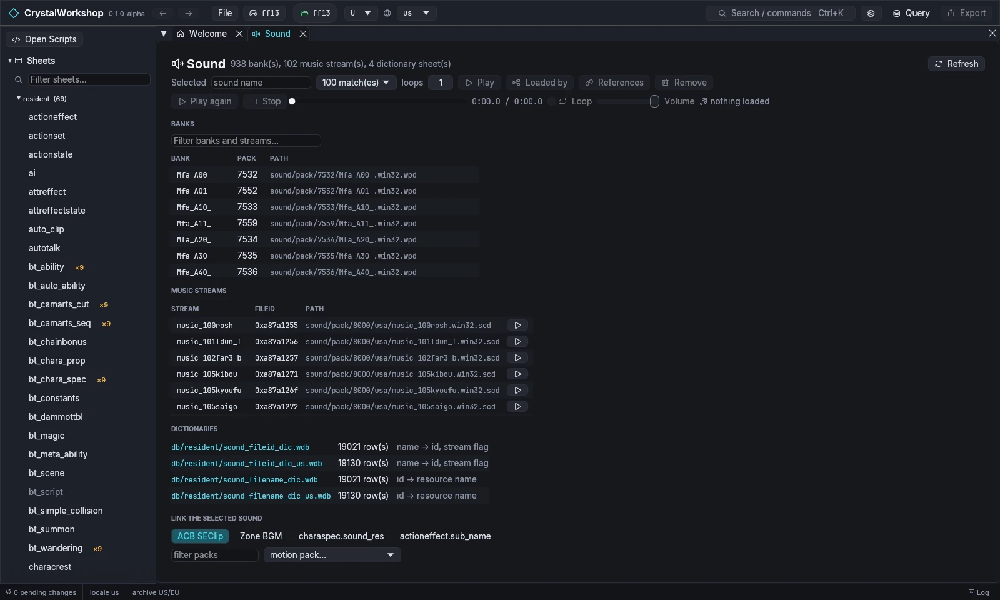

import { Tabs, TabItem, Steps, Aside, Badge, LinkCard, CardGrid } from '@astrojs/starlight/components';

{/* Generated by scripts/generate.mjs from the release docs. Edit the source, then run npm run generate. */}

**Goal:** read and change a CLB script as Java, look at an action schedule
(ACB) and its links, and browse the game's sound banks and music.

## Prerequisites

- A game open ([First Run and Game Setup](../first-run/)).
- **Scripts:** a JDK 17 or newer (`java` and `javac`, not just a Java
  runtime; see [Installing](../installing/)). Decompile, compile and export of script
  edits need it. The **Vineflower 1.12.0** decompiler is included. If
  CrystalWorkshop cannot find Java, it says so and names the fix: install a
  JDK, or set the `java` and `javac` paths under **Settings › Scripts
  toolchain** (**Detect toolchain** checks again).

## Scripts (CLB): view and compile — XIII

1. Choose **Open Scripts** at the top of the navigator. The Scripts page
   lists every CLB class (`SELECT id FROM scripts` lists them in the
   Query panel too). **Refresh scripts** reloads the list, and **Modified
   only** filters it.
2. Open a class, for example `btscene/clb/btsc_clb.bin#3`
   (`fsm_treasure_box`). The Java tab decompiles it. The status reads
   **Java source ready**.
3. The right panel shows the **API** of every game class and method, and
   the **Links** of this class (callers and references).
4. Edit the Java, then choose **Compile**. It runs javac, then verifies the
   class and merges it into the CLB. **Diagnostics** lists problems, such as
   Java features the game's VM does not support (string `switch`, lambdas,
   boxing, enums, for-each).
5. **Stage** keeps the compiled class as a pending change.
   - **Undo** / **Redo** step through your edits.
   - **Revert draft** drops the draft; **Revert to game** restores the
     original.
   - **Source**, **Diff**, **Side by side** and **Tools** switch views.

Exported scripts travel in shards as Java patches. PulseDepot recompiles
them against the player's game, so players of a mod that changes scripts
need a JDK 17 or newer too: without one, PulseDepot's review stops and asks
them to install it. With a JDK, PulseDepot merges script changes from
several mods class by class; when two mods change the same lines, the later
mod wins and the review reports the conflict.

**Limits (Experimental):**

- Script archives (SCR) are XIII only.
- XIII-2 and LR scripts can be browsed. Compiling them has not been tested.

## Actions (ACB / MCB schedules) and events

1. Open **Actions** in the navigator and pick a motion pack. For example,
   `sk_f092_zizo/s1` with the schedule `s1z_idle9.acb`.
2. The page shows:
   - **SCHEDULES:** the ACB/MCB rows, filterable;
   - the **Timeline** of tracks and clips;
   - the **node tree:** actors, tracks, blocks and clips;
   - the **ACB schedule** fields;
   - **Links** to the model, the effects, and the RID rows with the paired
     MCB.

   **VALID** means the file passes its checks.
3. **Edit:**
   - **Build a row from a spec…** creates a new schedule row. Choose
     **Preview**, then **Build**.
   - **Add clip**, **Clone** and **Remove** edit rows and clips.
   - **Undo**, **Redo** and **Revert** are in the toolbar.
   - **Export file** writes the edited file on its own.

**Events (cutscenes)** are under **Events** in the navigator:

- **Open the player** plays an event, with subtitles.
- **From/To playhead** limits playback to a range.
- **Export MP4** writes a video.

The player is a preview. It does not reproduce:

- lights, shadows, depth of field and glare;
- fog and colour correction;
- VFX, physics and movies.

Bink 2 movies cannot be previewed.

## Sound

1. Open **Sound** in the navigator. The page lists:
   - **banks** (`sound/pack/*.wpd`);
   - **music streams** (`.scd`);
   - the sound **dictionaries** (`sound_fileid_dic`, `sound_filename_dic`).
2. Pick a sound name. Then:
   - **Play** plays it, with **loops** setting the repeat count;
   - **Loaded by** and **References** show where it is used;
   - **Remove** deletes it.
3. **Link the selected sound** attaches a sound to one of:
   - an ACB SE clip;
   - zone BGM;
   - `charaspec.sound_res`;
   - `actioneffect.sub_name`.

   Importing new audio is under **Banks, music & import**.

**Limit:** sound is documented for XIII. It has no tests on XIII-2 or LR
yet.

## Undo / revert

Each page has **Undo**, **Redo** and **Revert**, and the **Changes** page
reverts a whole file.

## Related

[Simple Mod Export](../mod-export/) · [Model Edit](../model-edit/) · [VFX Edit](../vfx-edit/) · [Glossary](../glossary/)
