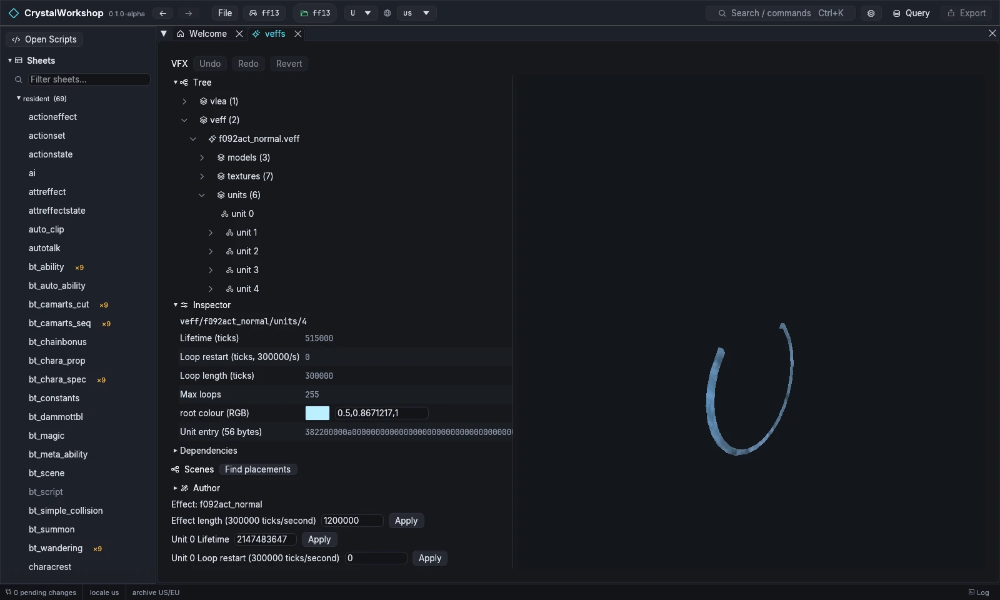
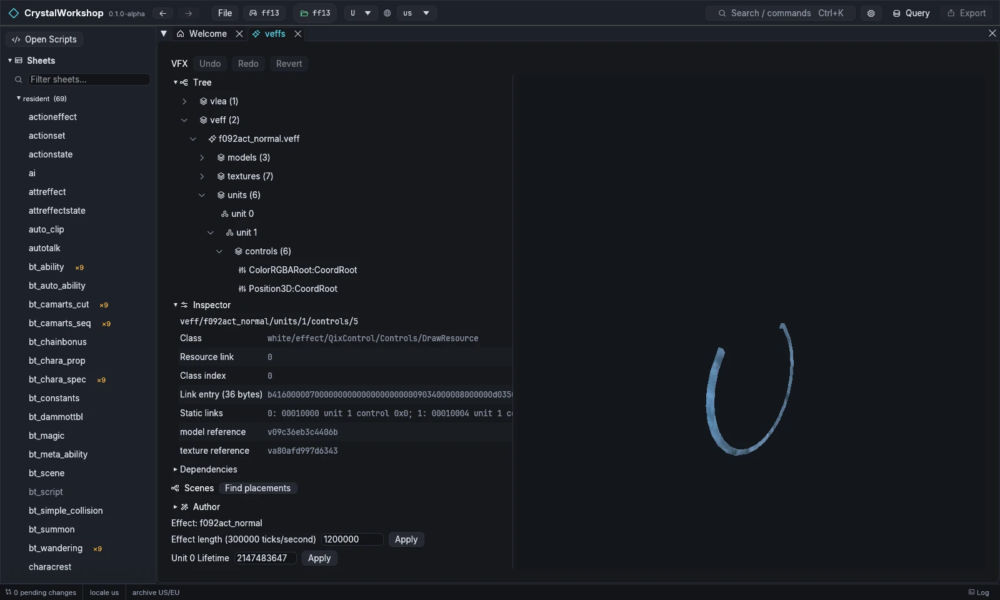

import { Tabs, TabItem, Steps, Aside, Badge, LinkCard, CardGrid } from '@astrojs/starlight/components';

{/* Generated by scripts/generate.mjs from the release docs. Edit the source, then run npm run generate. */}

**Goal:** open a monster's effect package, read its tree, change a field,
swap a texture or model reference, and play the effect.

## Prerequisites

- FINAL FANTASY XIII open ([First Run and Game Setup](../first-run/)). XIII-2 and LR
  packages open too, but their fields are read-only. See Known limits.
- DXVK and a GPU driver with Vulkan 1.3 support for playback with the
  game's shaders ([Installing](../installing/)).

## Background

An effect package (`vfx/.../veffs.<locale>.win32.xfv`) holds:

- **effects** (`veff`), each with:
  - its `models` and `textures`;
  - **units**, each with:
    - **controls** (what to draw);
    - an emitter (particles);
- **leaves** (`vlea`, where effects attach);
- **models** (`vmdl`).

## Steps

<Steps>

1. Open **VFX** in the navigator and pick a package. This example uses
   `vfx/chr/f092/v1/veffs.jp.win32.xfv` (`Ctrl+K` works too).
2. **The layout:**
   - **Left column (data):** the **Tree**, **Dependencies**, **Scenes ›
     Find placements**, **Author** and the **Inspector**.
   - **Right column (player):** the viewport. Drag the divider to resize
     the columns.
   - **Narrow windows:** below 700 px the columns stack, with the
     viewport on top.
3. **Select a node in the tree,** for example **veff › f092act_normal ›
   units › unit 4**. The **Inspector** shows one widget per typed field:
   - numbers, such as **Lifetime (ticks)**, **Loop restart**, **Loop
     length** and **Max loops**;
   - colours, with a swatch, such as **root colour (RGB)**;
   - raw entries, shown read-only as hex.

   

4. **Change a field:** edit **Lifetime** or **root colour**, then choose
   **Apply**. Fields that cannot be written safely stay read-only and say
   why.
5. **Swap a reference:** select a **control** node (`units › unit N ›
   controls`). Its **model**, **texture.k** or **item.n.model** field is a
   list of safe targets: other names of the same type in this effect's own
   reference table. Pick one and choose **Apply**. Unsafe swaps, such as a
   texture from another package or a different shape, are read-only and say
   why.

   

6. **Play:** the player has these controls:
   - **Play effect** / **Pause effect**, **Restart effect** and **Loop
     effect**;
   - the **Playback time** slider;
   - **Random seed** and **Ground height**;
   - an anchor panel.

   A **Partial: N of M parts** banner lists the parts the player cannot
   draw yet. When an effect's materials are not supported, the viewport
   shows a **geometry preview** (opaque, no blending) instead, as in the
   screenshots on this page.
7. **Author › Check XIII loading** checks that the package will load in XIII.

</Steps>

## Result

The package shows as changed and is listed on the **Changes** page. Export
it with [Simple Mod Export](../mod-export/).

## Undo / revert

**Undo**, **Redo** and **Revert** are in the VFX toolbar. Revert returns the
package to the game's original. Setting a field back to its original value
also unstages it.

## Known limits (Experimental)

- **Per-game support:**
  - **XIII:** fields are editable.
  - **XIII-2 and LR:** fields are read-only and marked "not proven for
    *game*". Reference swaps work in all three games.
  - **LR:** ribbon, light and tint parts are refused in playback.
- **Playback** is not yet a full match for the game's renderer:
  - ground ray casts use a flat plane;
  - some parts play only partly (see the banner).
- **Not yet supported:**
  - editing animated curves;
  - inserting a new unit.

## Related

[Model Edit](../model-edit/) · [Scene Edit](../scene-edit/) · [Simple Mod Export](../mod-export/) · [Glossary](../glossary/)
