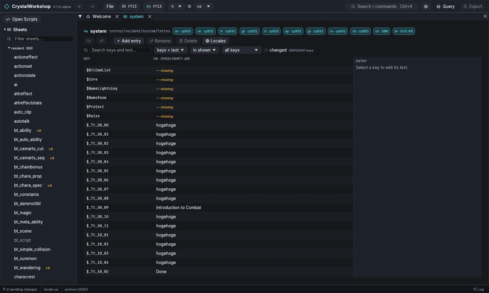
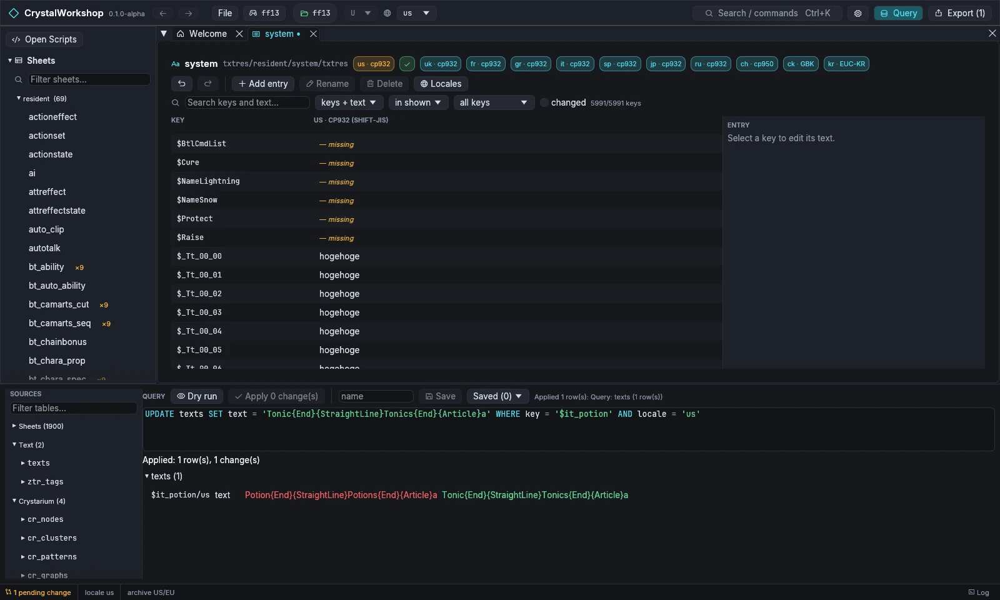

import { Tabs, TabItem, Steps, Aside, Badge, LinkCard, CardGrid } from '@astrojs/starlight/components';

{/* Generated by scripts/generate.mjs from the release docs. Edit the source, then run npm run generate. */}


**Goal:** rename the Potion in the menus, keep its control tags intact, and
check it in other locales.

## Prerequisites

- A game open ([First Run and Game Setup](../first-run/)). This example uses XIII.

## Background

Game text lives in ZTR files, grouped as `txtres/<area>/<name>/txtres`, one
file per locale:

| Game | Locales |
|---|---|
| XIII | `us uk fr gr it sp jp ru ch ck kr` |
| XIII-2 | 11 locales |
| LR | 8 locales |

Entries carry **control tags** in braces:

- `{End}` ends a string;
- `{StraightLine}` separates the singular from the plural;
- `{Article}` gives the article;
- colours and icons, such as `{Color Sapphire}` (LR).

Each game has its own tag palette.

## Steps

<Steps>

1. Open **Text** in the navigator, or `Ctrl+K` › *Open Text*. The list shows
   each text group with its area, locales and path.
2. Open **system** (`txtres/resident/system/txtres`). The badges show each
   locale and its code page (for example `us · cp932`, `kr · EUC-KR`).
3. Search for `$it_potion` in **Search keys and text…**, then select the key.
   The **ENTRY** panel on the right edits it. Use **Insert control code**
   to add a tag instead of typing it.
4. Choose **Apply**. **Revert** drops your draft.
5. **Locales** chooses which locales are shown side by side, so you can
   update `uk`, `fr` and the rest too.
6. The toolbar has **Add entry**, **Rename** and **Delete** for keys. The
   filters (*keys + text*, *in shown*, *all keys* and *changed*) narrow the
   list.

</Steps>



### The same change with SQL

The `texts` table has these columns: `key`, `locale`, `file`, `text`
(with tags), `plain` (without tags), `rendered` and `missing`.

```sql
SELECT key, locale, text FROM texts WHERE key = '$it_potion'
UPDATE texts SET text = 'Tonic{End}{StraightLine}Tonics{End}{Article}a'
  WHERE key = '$it_potion' AND locale = 'us'
SELECT locale, ztr_validate(text, locale) FROM texts WHERE key = '$it_potion'
```

`ztr_validate` reports any tag the game would not understand.



## Result

The group shows as changed, and the **Changes** page lists the locale's
`.ztr` file. Export it with [Simple Mod Export](../mod-export/).

## Undo / revert

- **Revert** in the entry panel, or **Undo** in the group toolbar.
- On the **Changes** page, revert the file.

## Known limits

- **Preview with record…**, which renders the text with a sheet record, is
  XIII only.
- Shards built from XIII-2 or LR text are not verified in game yet.

## Related

[Simple DB Edit](../db-edit/) · [Simple Mod Export](../mod-export/) · [Glossary](../glossary/)
