import { Tabs, TabItem, Steps, Aside, Badge, LinkCard, CardGrid } from '@astrojs/starlight/components';
import ModHeader from '../../../components/ModHeader.astro';
import ChangelogList from '../../../components/ChangelogList.astro';

{/* Generated by scripts/generate.mjs from the release docs. Edit the source, then run npm run generate. */}

<ModHeader id="drop-changes" />

Choose what FINAL FANTASY XIII (Steam) gives you after battles and from treasure:

- drop chances and quantities;
- shroud drops;
- Crystarium Points (CP), and gil as a share of the CP;
- how many of an item you can carry;
- treasure-box quantities;
- catalog bonuses;
- what the battle results screen shows.

Drop Changes is set for each save slot, and it is **off** until you turn it on for the slot you play.

## Screenshots

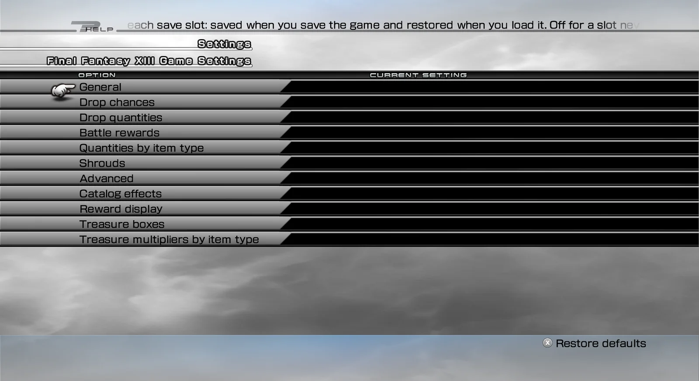
_Drop Changes — settings categories_

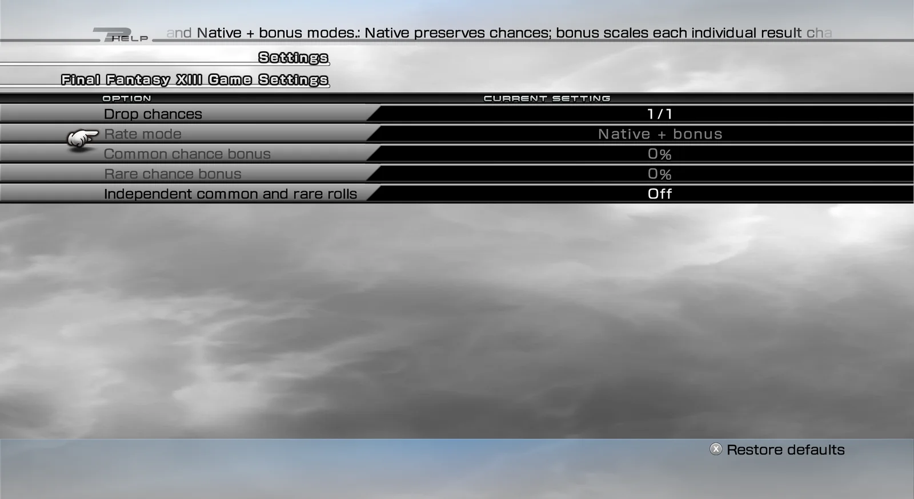
_Drop Changes — drop chance settings_

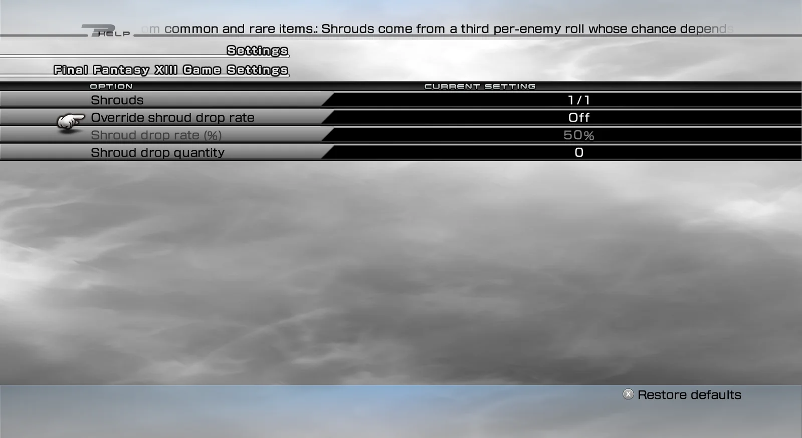
_Drop Changes — shroud drop settings_

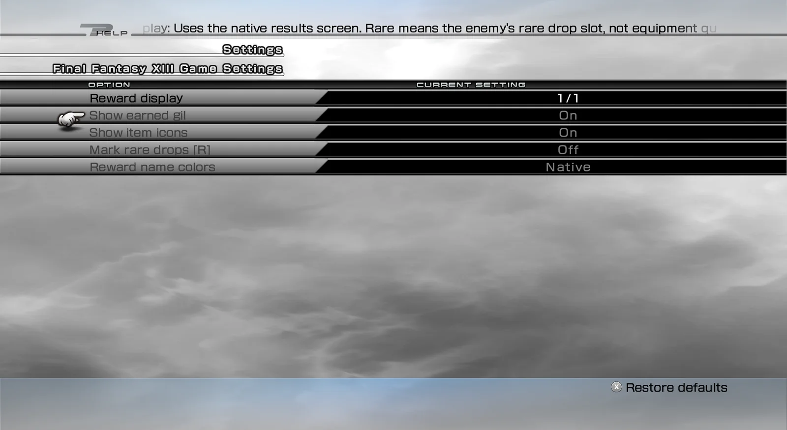
_Drop Changes — battle results display settings_

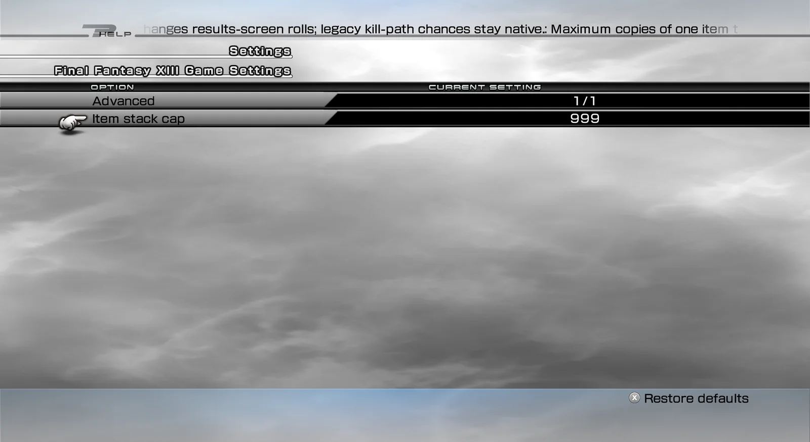
_Drop Changes — advanced settings_

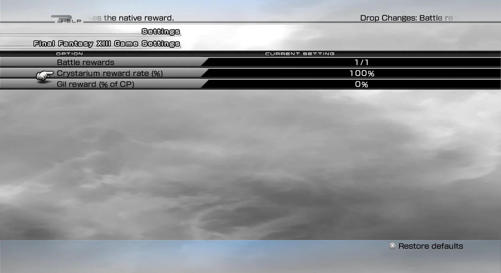
_Drop Changes — battle reward settings_

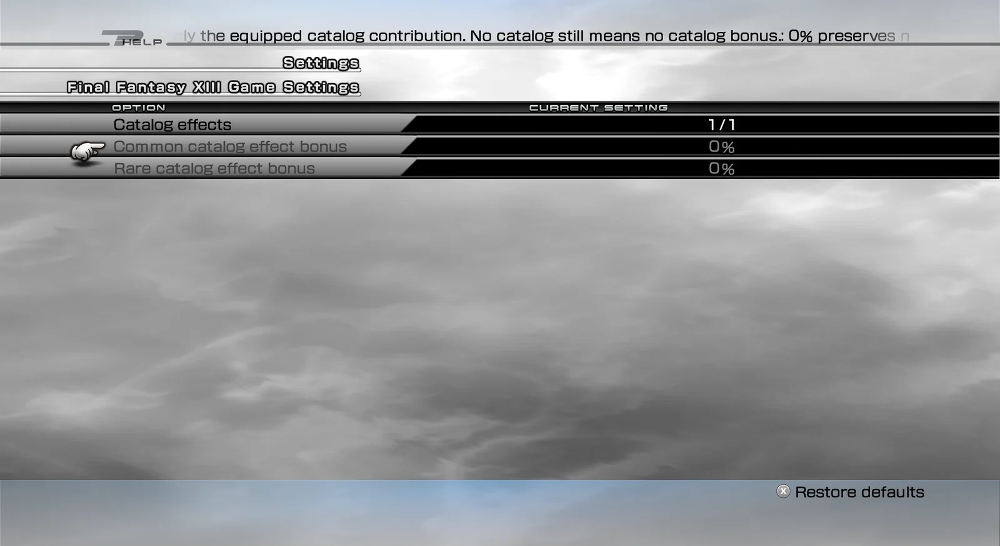
_Drop Changes — catalog effect settings_

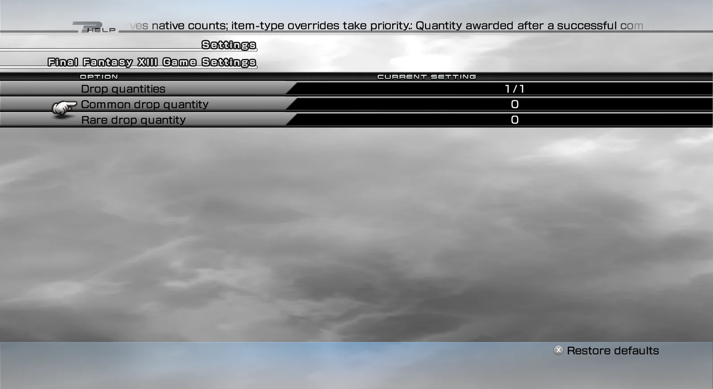
_Drop Changes — drop quantity settings_

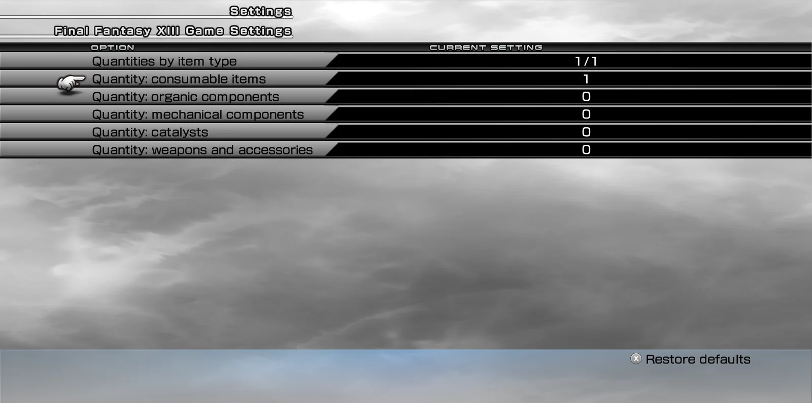
_Drop Changes — drop quantities by item type_

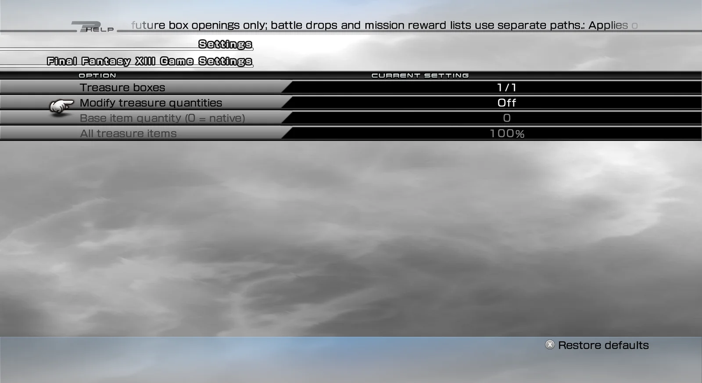
_Drop Changes — treasure box settings_

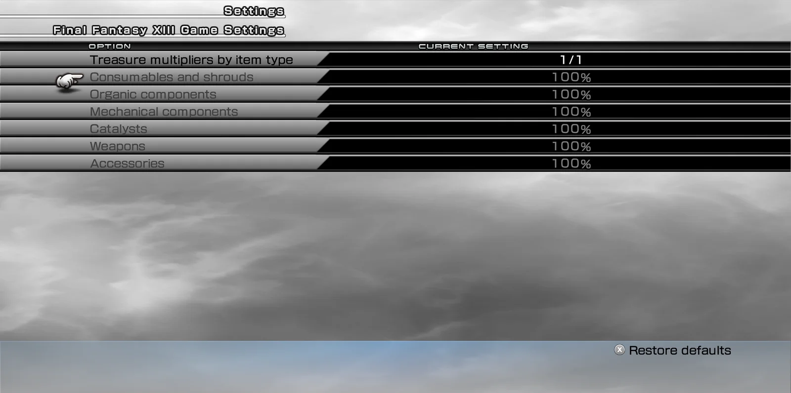
_Drop Changes — treasure multipliers by item type_

## Features

- **Drop chances.** Three modes:
  - *Native* keeps the normal chances.
  - *Native + bonus* raises each chance by your bonus, and keeps the enemy's own rates, catalogs and battle rating.
  - *Fixed chance* sets one chance for all common drops and one for all rare drops.
- **Independent rolls.** Common and rare drops can be rolled separately, so one enemy can drop both.
- **Quantities.** Set how many items common and rare drops give, with separate amounts for consumables, organic components, mechanical components, catalysts, and weapons and accessories.
- **Shrouds.** Optionally set the shroud drop chance and quantity yourself.
- **Battle rewards.** Change the CP you earn. Optionally earn gil after battles, as a percentage of the CP (the normal game gives no gil).
- **Treasure boxes.** A base quantity, a general multiplier and multipliers by item type. Only boxes you open from now on are affected.
- **Catalogs.** Extra bonus on top of the equipped catalog's effect.
- **Results screen.** Can show:
  - an "Earned gil" row;
  - item icons;
  - an [R] marker for rare drops;
  - name colours by rarity or item type.
- **Item limit.** The normal game lets you carry 99 of each item. With the mod on, the limit is 999 by default, and you can set it from 99 to 9999 (Advanced group).
- **Languages.** Menu texts in all eleven game languages.

## Requirements

- FINAL FANTASY XIII, Steam version, on Windows or on Linux (Proton).
- **PulseDepot** (beta), the mod manager. It also installs **Crux**, which loads this mod in the game.
- **XIII — Mod Settings** 0.1.0, for the in-game settings menu. Without it you cannot turn Drop Changes on.

## Install

<Steps>

1. Download `xiii-drop-changes-0.1.0.cws` and `xiii-mod-settings-0.1.0.cws`.
2. In PulseDepot, choose **Add mod…** and add both files.
3. Choose **Apply changes**.
4. Start the game from Steam as usual.

</Steps>

## Settings

Open **Configuration → Mod Settings → Drop Changes**.

| Group | Settings | Default |
|---|---|---|
| General | Enable Drop Changes (this save slot) | Off |
| Drop chances | Rate mode; common / rare bonus; fixed common / rare chance; independent rolls | Native + bonus, +0%, 50%, off |
| Drop quantities | Common / rare drop quantity (0 = normal) | 0 / 0 |
| Battle rewards | Crystarium reward rate; gil reward (% of CP) | 100% / 0% |
| Quantities by item type | Consumables, organic, mechanical, catalysts, weapons and accessories (0 = normal) | 0 |
| Shrouds | Override shroud drop rate; chance; quantity | Off, 50%, 0 |
| Advanced | Item stack cap | 999 |
| Catalog effects | Common / rare catalog effect bonus | +0% / +0% |
| Reward display | Earned gil; item icons; [R] marker; name colours | On, on, off, Native |
| Treasure boxes | Modify treasure quantities; base quantity; multipliers | Off, 0, 100% |

How settings follow your saves:

- Your settings are stored with your next game save and come back when you load that slot.
- A slot that was never saved with Drop Changes starts with it off.
- With the mod off for a slot, that slot plays exactly like the normal game.

## Compatibility

- Steam version only. If your game version is not recognised, the mod stays inactive and the game plays as usual. The reason is written to the Crux log.
- Other mods that also change drops, rewards or the results screen may stack with Drop Changes or override it.
- The items and gil you receive are normal game items and are saved by the game as usual.
- If an earlier stand-alone version of Drop Changes is installed, remove it first. Its settings are not carried over.

## Uninstall

In PulseDepot, choose **Remove from library**, then **Apply changes**.

Your saves are never changed by the mod itself, and the items and gil you already received stay yours. Your Drop Changes settings are kept by Crux and come back if you install the mod again.

## Known issues

- This first release has not been played through in the game yet. Please report problems and attach the Crux log.
- Item counts above 99: the game keeps the full count, but its menus only have room for two digits. Keep the item limit at 99 if you might remove the mod later.
- Settings you change in the menu are kept only if you save the game afterwards.

## Permissions

- Free to download and use for personal play.
- Please do not re-upload this mod or share the file anywhere else. Share a link to the official mod page instead.
- Do not modify, decompile for re-release, or sell this mod or any part of it without the author's written permission.

## Credits

- Made with CrystalWorkshop.
- Includes open-source components; see [its third-party notices](../../legal/third-party/).

## Changelog

<ChangelogList product="drop-changes" />
