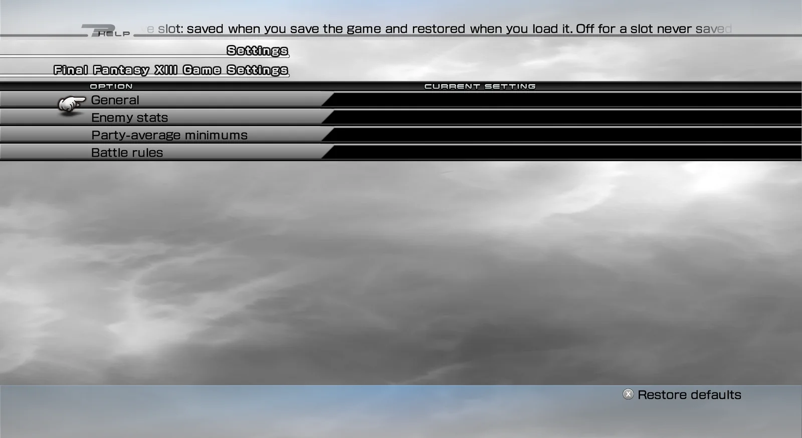
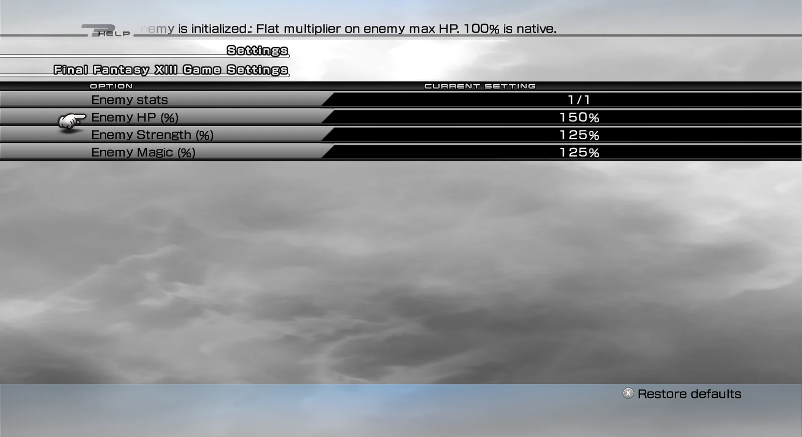
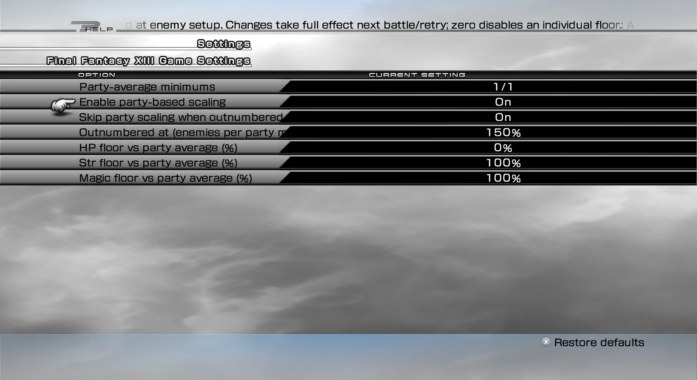
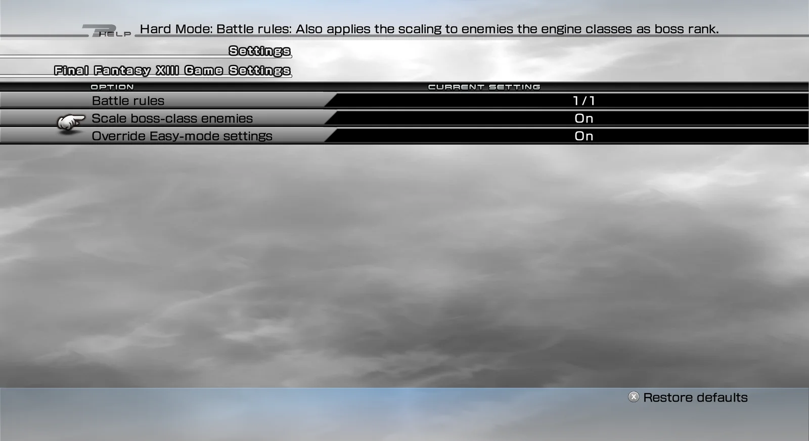

import { Tabs, TabItem, Steps, Aside, Badge, LinkCard, CardGrid } from '@astrojs/starlight/components';
import ModHeader from '../../../components/ModHeader.astro';
import ChangelogList from '../../../components/ChangelogList.astro';

{/* Generated by scripts/generate.mjs from the release docs. Edit the source, then run npm run generate. */}

<ModHeader id="hard-mode" />

Hard Mode makes the enemies in FINAL FANTASY XIII (Steam) tougher. When a battle starts, each enemy is made stronger:

- its maximum HP, Strength and Magic are multiplied by amounts you choose;
- optionally, its stats are raised to at least a share of your battle party's average.

While Hard Mode is on, the game's Easy difficulty and Easy battle-speed options can also be ignored.

Hard Mode is set for each save slot, and it is **off** until you turn it on for the slot you play.

## Screenshots

_Hard Mode — settings categories_

_Hard Mode — enemy stats settings_

_Hard Mode — party-average minimum settings_

_Hard Mode — battle rule settings_

## Features

- **Stronger enemies.** Multipliers for enemy max HP (default 150%), Strength (125%) and Magic (125%). 100% is the normal game value.
- **Minimums based on your party.** Optional minimums for enemy HP, Strength and Magic, as a percentage of your battle party's average. You can switch them off together, or set one to 0 to switch off just that one.
- **Outnumber guard.** When the enemies outnumber your party by the ratio you choose (default 1.5 enemies per party member), the party-based minimums are skipped for that battle.
- **Bosses.** Bosses are made stronger too, unless you turn this off.
- **Easy-mode override.** While Hard Mode is on, the Easy difficulty and Easy battle-speed options count as off. Your game options themselves are not changed.
- **Languages.** Menu texts in all eleven game languages.

## Requirements

- FINAL FANTASY XIII, Steam version, on Windows or on Linux (Proton).
- **PulseDepot** (beta), the mod manager. It also installs **Crux**, which loads this mod in the game.
- **XIII — Mod Settings** 0.1.0, for the in-game settings menu. Without it you cannot turn Hard Mode on.

## Install

<Steps>

1. Download `xiii-hard-mode-0.1.0.cws` and `xiii-mod-settings-0.1.0.cws`.
2. In PulseDepot, choose **Add mod…** and add both files.
3. Choose **Apply changes**.
4. Start the game from Steam as usual.

</Steps>

## Settings

Open **Configuration → Mod Settings → Hard Mode**.

| Group | Setting | Default | Effect |
|---|---|---|---|
| General | Enable Hard Mode (this save slot) | Off | Turns Hard Mode on or off for the save slot you play |
| Enemy stats | Enemy HP / Strength / Magic (%) | 150 / 125 / 125 | Multiplies each enemy's max HP, Strength and Magic |
| Party-average minimums | Enable party-based scaling | On | Switches all party-based minimums on or off |
| | Skip party scaling when outnumbered | On | Turns the outnumber guard on or off |
| | Outnumbered at (enemies per party member, %) | 150 | How many enemies per party member count as outnumbered (150 = 1.5) |
| | HP / Strength / Magic floor vs party average (%) | 0 / 100 / 100 | The minimum for each enemy stat; 0 switches that one off |
| Battle rules | Scale boss-class enemies | On | Makes bosses stronger too |
| | Override Easy-mode settings | On | Ignores Easy difficulty and Easy battle speed while Hard Mode is on |

How settings follow your saves:

- Your settings are stored with your next game save and come back when you load that slot.
- A slot that was never saved with Hard Mode starts with Hard Mode off.
- If you start a new game, the choices you made on the title screen carry over into it.
- Changes take effect at the next battle or retry.

## Compatibility

- Steam version only. If your game version is not recognised, the mod stays inactive and the game plays as usual. The reason is written to the Crux log.
- Other mods that also change enemy stats may stack with Hard Mode or override it.
- If an earlier stand-alone version of Hard Mode is installed, remove it first. Its settings are not carried over.

## Uninstall

In PulseDepot, choose **Remove from library**, then **Apply changes**.

Your saves are never changed by this mod and load as normal saves. Your Hard Mode settings are kept by Crux and come back if you install the mod again.

## Known issues

- This first release has not been played through in the game yet. Please report problems and attach the Crux log.
- Settings you change in the menu are kept only if you save the game afterwards.

## Permissions

- Free to download and use for personal play.
- Please do not re-upload this mod or share the file anywhere else. Share a link to the official mod page instead.
- Do not modify, decompile for re-release, or sell this mod or any part of it without the author's written permission.

## Credits

- Made with CrystalWorkshop.
- Includes open-source components; see [its third-party notices](../../legal/third-party/).

## Changelog

<ChangelogList product="hard-mode" />
