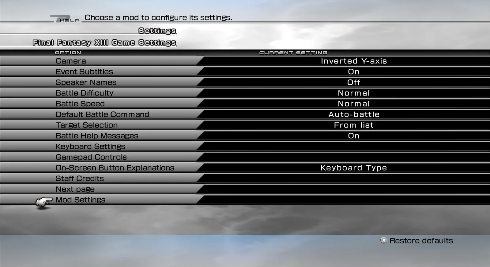
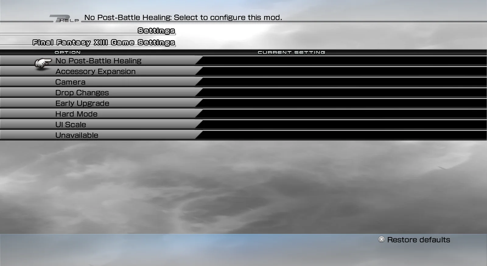

import { Tabs, TabItem, Steps, Aside, Badge, LinkCard, CardGrid } from '@astrojs/starlight/components';
import ModHeader from '../../../components/ModHeader.astro';
import ChangelogList from '../../../components/ChangelogList.astro';

{/* Generated by scripts/generate.mjs from the release docs. Edit the source, then run npm run generate. */}

<ModHeader id="mod-settings" />

Adds **Configuration → Mod Settings** to FINAL FANTASY XIII (Steam): one in-game menu for the settings of every installed mod that has them, such as Hard Mode and Drop Changes.

## Screenshots

_Mod Settings — entry in the game's Settings menu_

_Mod Settings — list of installed mods_

## Features

- **One menu for all mods.** The menu lists each installed mod, then that mod's setting groups, then the settings in the group you pick. Long lists are split into pages.
- **Controls.**
  - **Left/Right** changes a value.
  - **Confirm** opens a page, toggles a switch or presses a button.
  - **Back** returns step by step to the game's own Configuration list.
- **NovaFix add-ons.** Add-ons for NovaFix that have settings are shown too.
- **Your language.** The menu uses the game's language. The menu's own texts come in all eleven game languages, and each mod brings its own texts.
- **Nothing to configure.** The menu has no settings of its own and stores nothing. Each mod keeps its own settings.

## Requirements

- FINAL FANTASY XIII, Steam version, on Windows or on Linux (Proton).
- **PulseDepot** (beta), the mod manager. It also installs **Crux**, which loads this mod in the game.

Hard Mode, Drop Changes and other mods with in-game settings need this mod.

## Install

<Steps>

1. Download `xiii-mod-settings-0.1.0.cws`.
2. In PulseDepot, choose **Add mod…** and add the file.
3. Choose **Apply changes**.
4. Start the game from Steam as usual.

</Steps>

## Settings

The menu has no settings of its own. Open **Configuration → Mod Settings** to see your installed mods and change their settings.

## Compatibility

- Steam version only. If your game version is not recognised, the menu is not added and the game plays as usual. The reason is written to the Crux log.
- If another mod already changes the game's Configuration menu, this menu may not be added.

## Uninstall

In PulseDepot, choose **Remove from library**, then **Apply changes**.

Your saves are never changed by this mod. Mods that use this menu keep working with the settings they already have, but you can no longer change those settings in the game.

## Known issues

- This first release has not been played through in the game yet. Please report problems and attach the Crux log.
- A setting text that a mod does not provide shows as "Unavailable".

## Permissions

- Free to download and use for personal play.
- Please do not re-upload this mod or share the file anywhere else. Share a link to the official mod page instead.
- Do not modify, decompile for re-release, or sell this mod or any part of it without the author's written permission.

## Credits

- Made with CrystalWorkshop.
- Includes open-source components; see [its third-party notices](../../legal/third-party/).

## Changelog

<ChangelogList product="mod-settings" />
