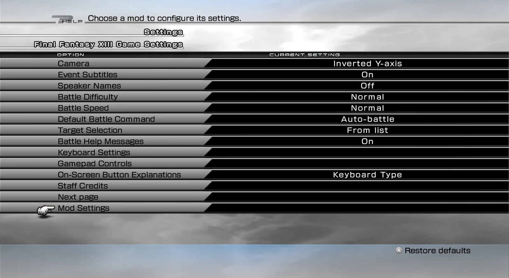

**Configuration → Mod Settings** is the in-game menu for the settings of your mods. It comes with **Crux**, which PulseDepot installs with your mods, so there is nothing extra to download.

_Mod Settings at the end of the game's Configuration list_

## Where it is

1. In the game, open the **Configuration** menu.
2. Choose **Mod Settings**, the last row of the list.
3. Choose a mod, then one of its groups, then change its settings. A mod with only one group opens straight on its settings.

The **Mod Settings** row appears only when at least one installed mod has settings for the game you are playing.

Each mod's page lists what you can set there. For example, Hard Mode's settings are under **Configuration → Mod Settings → Hard Mode**.

## What it shows

- **Your mods for this game.** Every installed mod that has settings for the game you are playing.
- **Pages.** Long lists are split into pages: use **Previous page** and **Next page**.
- **Controls.**
  - **Left/Right** changes a value.
  - **Confirm** opens a page, toggles a switch or presses a button.
  - **Back** returns step by step to the game's own Configuration list.
- **Your language.** The menu uses the game's language. Each mod brings the texts of its own settings; a setting whose text a mod does not provide is not shown, and the [Crux log](../../crux/logs/) names it.
- **NovaFix add-ons.** In FINAL FANTASY XIII, NovaFix add-ons that have settings are shown too.

The menu stores nothing itself: each mod keeps its own settings. It never changes your saves or the game's own options.

## Games

- FINAL FANTASY XIII, Steam version.
- FINAL FANTASY XIII-2, Steam version, and the Microsoft Store version (experimental).
- LIGHTNING RETURNS, Steam version (experimental).

If your game version is not recognised, the Mod Settings row is not added and the game plays as usual. The reason is written to the [Crux log](../../crux/logs/).

## Coming from XIII Mod Settings

The menu used to be a separate mod, **XIII Mod Settings**. It is now part of Crux, so you no longer need that mod. The next time you apply changes, PulseDepot turns it off and tells you so. Its file stays in your library; you can remove it with **Remove from library**. Your mods keep their settings.

## For mod authors

Add your mod's settings to this menu with the extension SDK: see [In-game settings](../../sdk/settings/).
