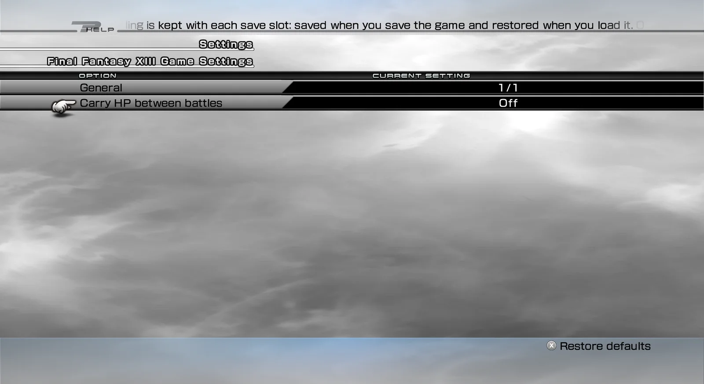

import { Tabs, TabItem, Steps, Aside, Badge, LinkCard, CardGrid } from '@astrojs/starlight/components';
import ModHeader from '../../../components/ModHeader.astro';
import ChangelogList from '../../../components/ChangelogList.astro';

{/* Generated by scripts/generate.mjs from the release docs. Edit the source, then run npm run generate. */}

<ModHeader id="no-post-battle-heal" />

No Post-Battle Healing makes the damage your party takes in FINAL FANTASY XIII (Steam) last. After a victory, each party member keeps the HP they had left and starts their next battle with it, instead of being fully healed.

To help you recover, the mod adds **Restorisol**, a single-use shroud sold at Unicorn Mart that restores the whole party.

No Post-Battle Healing is set for each save slot, and it is **off** until you turn it on for the slot you play.

## Screenshots

_No Post-Battle Healing — settings_

## Features

- **HP carries over.** Each party member starts the next battle with the HP they had after the last victory, up to their current maximum HP.
- **Knocked out stays hurt.** A member who was knocked out starts the next battle with 1 HP.
- **Defeats and retries are fair.** A defeat or a retry never replaces the HP from your last victory.
- **Every character tracked.** Lightning, Snow, Hope, Sazh, Vanille and Fang each keep their own HP, also when the party changes. Guest characters are healed as usual.
- **Restorisol.** A field shroud from Unicorn Mart (1,000 gil). Use it from the menu: the whole party, reserves included, starts the next battle at full HP. It does not restore TP.
- **Languages.** Menu and item texts in all eleven game languages.

## Requirements

- FINAL FANTASY XIII, Steam version, on Windows or on Linux (Proton).
- **PulseDepot** (beta), the mod manager. It also installs **Crux**, which loads this mod in the game.
- **XIII — Mod Settings** 0.1.0, for the in-game settings menu. Without it you cannot turn the mod on.

## Install

<Steps>

1. Download `no-post-battle-heal-0.1.0.cws` and `xiii-mod-settings-0.1.0.cws`.
2. In PulseDepot, choose **Add mod…** and add both files.
3. Choose **Apply changes**.
4. Start the game from Steam as usual.

</Steps>

## Settings

Open **Configuration → Mod Settings → No Post-Battle Healing**.

| Group | Setting | Default | Effect |
|---|---|---|---|
| General | Carry HP between battles | Off | Turns the mod on or off for the save slot you play |

How the setting follows your saves:

- The switch and the carried HP are stored with your next game save and come back when you load that slot.
- A slot that was never saved with the mod starts with it off.
- Off, the party is fully healed after every battle as usual, and Restorisol has no effect. When you turn it on again, the party starts at full HP until the next victory.
- A new game starts with full HP and keeps the switch.

## Compatibility

- Steam version only. If your game version is not recognised, the mod stays inactive and the game plays as usual. The reason is written to the Crux log.
- Other mods that change how HP is restored after battle may conflict with this one.
- If an earlier version named "No Post-Battle Healing + Restorisol" is in your PulseDepot list, remove it before you add this one.

## Uninstall

In PulseDepot, choose **Remove from library**, then **Apply changes**.

Your saves are never changed by this mod and load as normal saves. Your settings and carried HP are kept by Crux and come back if you install the mod again.

## Known issues

- This first release has not been played through in the game yet. Please report problems and attach the Crux log.
- The setting you change in the menu is kept only if you save the game afterwards.
- Restorisol belongs to the mod: use it before you uninstall.

## Permissions

- Free to download and use for personal play.
- Please do not re-upload this mod or share the file anywhere else. Share a link to the official mod page instead.
- Do not modify, decompile for re-release, or sell this mod or any part of it without the author's written permission.

## Credits

- Made with CrystalWorkshop.
- Includes open-source components; see [its third-party notices](../../legal/third-party/).

## Changelog

<ChangelogList product="no-post-battle-heal" />
