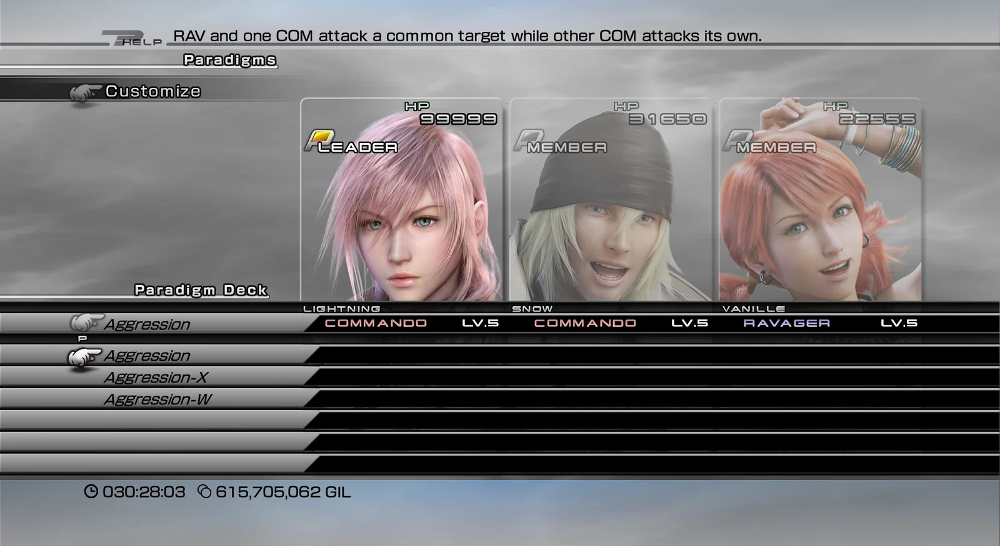

import { Tabs, TabItem, Steps, Aside, Badge, LinkCard, CardGrid } from '@astrojs/starlight/components';
import ModHeader from '../../../components/ModHeader.astro';
import ChangelogList from '../../../components/ChangelogList.astro';

{/* Generated by scripts/generate.mjs from the release docs. Edit the source, then run npm run generate. */}

<ModHeader id="paradigm-tuning" />

Paradigm Tuning makes the party AI in FINAL FANTASY XIII (Steam) smarter, and lets you choose how your companions pick their targets in each paradigm. In the Paradigm Deck, every paradigm can be **Normal**, **Cross (-X)** or **Wide (-W)**:

- **Normal** keeps the usual targeting.
- **Cross** focuses your companions on the leader's target.
- **Wide** spreads companions of the same role over different enemies.

Your choices are kept for each save slot.

## Screenshots

_Paradigm Tuning — new paradigms in the Paradigm Deck_

## Features

- **A choice for every paradigm.** Pick Normal, Cross or Wide for each paradigm in the Paradigm Deck. The choice is shown on the paradigm's name in the deck and on the paradigm labels in battle, for example "Relentless Assault-X".
- **Cross (-X):**
  - Commandos and Ravagers attack the leader's target when it suits them.
  - Sentinels prefer the leader's target and use single-target Provoke.
  - Saboteurs prefer the leader's target and use single-target debuffs.
  - Synergists prefer to enhance the leader when the choices are otherwise equal.
- **Wide (-W):**
  - Companions of the same role prefer enemies that fewer of them are already attacking.
  - Sentinels use area Provoke against two or more enemies that are not yet provoked.
  - Saboteurs use area debuffs against two or more enemies they can affect.
- **Smarter AI in every paradigm:**
  - Synergists queue several enhancements at once.
  - Saboteurs keep casting and mix their debuffs.
  - Medic healing is unchanged.
- **No idle companions.** If a Commando or Ravager cannot act on its Cross or Wide target, it attacks its usual target instead.
- **Help texts.** The help line in the Paradigm Deck explains what Cross or Wide does for the roles of that paradigm, in all eleven game languages.

## Requirements

- FINAL FANTASY XIII, Steam version, on Windows or on Linux (Proton).
- **PulseDepot** (beta), the mod manager. It also installs **Crux**, which loads this mod in the game.
- No settings menu is needed: you make your choices in the Paradigm Deck.

## Install

<Steps>

1. Download `paradigm-tuning-0.1.0.cws`.
2. In PulseDepot, choose **Add mod…** and add the file.
3. Choose **Apply changes**.
4. Start the game from Steam as usual.

</Steps>

## Using the mod

Open **Paradigms → Paradigm Deck**:

<Steps>

1. Move the cursor onto a paradigm's name.
2. Press Confirm.
3. Pick Normal, Cross or Wide.

</Steps>

How your choices follow your saves:

| When | What happens |
|---|---|
| You start the game or a new game | Every paradigm is Normal |
| You save the game | Your choices are stored with that save slot |
| You load a save | That slot's choices come back. A slot never saved with the mod is all Normal |
| A save fails or you cancel it | Nothing is stored |

## Compatibility

- Steam version only. If your game version is not recognised, the mod stays inactive and the game plays as usual. The reason is written to the Crux log.
- Conflicts with other mods that change the party AI.
- If an earlier stand-alone version of Paradigm Tuning is installed, this version stays inactive until you remove the old one. Choices made with the old version are not carried over: every save slot starts Normal.

## Uninstall

In PulseDepot, choose **Remove from library**, then **Apply changes**.

Your saves are never changed by this mod. Your paradigms, roles and decks stay exactly as the game saved them, and the party AI is back to normal.

## Known issues

- This first release has not been played through in the game yet. If a companion stands idle or something else looks wrong, please report it and attach the Crux log.
- In some languages the help texts may be too long for the help line.

## Permissions

- Free to download and use for personal play.
- Please do not re-upload this mod or share the file anywhere else. Share a link to the official mod page instead.
- Do not modify, decompile for re-release, or sell this mod or any part of it without the author's written permission.

## Credits

- Made with CrystalWorkshop.
- Includes open-source components; see [its third-party notices](../../legal/third-party/).

## Changelog

<ChangelogList product="paradigm-tuning" />
