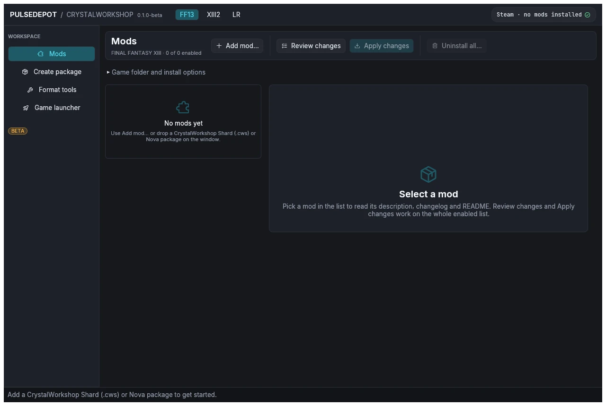

import { Steps } from '@astrojs/starlight/components';

**Goal:** PulseDepot knows your game folder, and you know which Crux build it will install.

<Steps>

1. **Start PulseDepot and pick the game.** The **FF13 / XIII2 / LR** tabs at the top switch games. Each game keeps its own folder, mod list and launcher options.

   On the very first start nothing is listed yet, and **Game folder and install options** is open.

   

2. **Check the game folder.** If PulseDepot found your Steam install, the header reads `Steam · no mods installed` and the folder is filled in. Otherwise choose **Browse…** in **Game folder and install options** and pick the folder that contains:

   - `white_data` for FINAL FANTASY XIII;
   - `alba_data` for FINAL FANTASY XIII-2;
   - the LR game files for LIGHTNING RETURNS.

   

3. **Choose the archive and optional data.** In **Game folder and install options**:

   | Option | What it does |
   |---|---|
   | **Archive** | US/EU or Asian archives (LR: English or Japanese voice). Use the one your game runs. |
   | **Optional data** | Install a mod's English or Japanese voice/text data as well. |

   

4. **Choose how Crux runs.** **Crux host** decides which Crux build PulseDepot installs when you apply:

   - **Automatic** (the default): the NovaFix addon when NovaFix is installed (`d3d9.dll` and `NovaFix.ini` beside the game executable), otherwise the standalone `version.dll`.
   - **NovaFix addon (Crux.dll)**: always the addon. NovaFix's own `d3d9.dll` is never shipped or changed by PulseDepot.
   - **Standalone (version.dll)**: always the standalone build, beside the game executable.

   

   Keep **Automatic** unless you know you need one build. On Linux, the standalone build needs the Steam launch option `WINEDLLOVERRIDES="version=n,b" %command%` (see [Install](../install/)). [Standalone or NovaFix addon](../../crux/hosts/) explains the difference.

</Steps>

**Result:** the header names the game install and its edition. Nothing has been written yet: PulseDepot only writes when you choose **Apply changes**.

Next: [2. Install shard mods (.cws)](../install-shards/).
