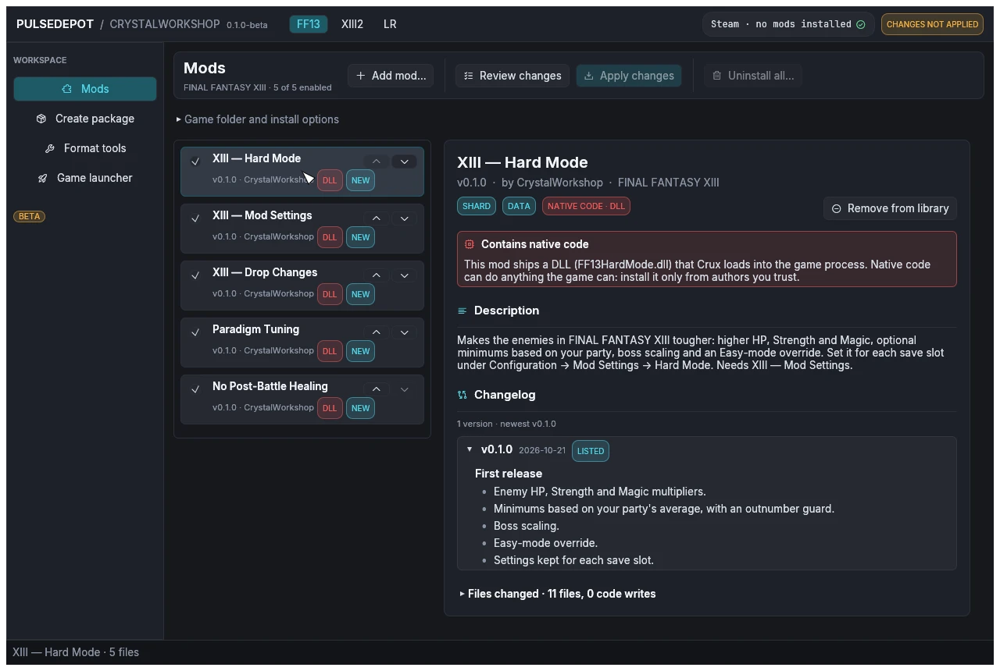

import { CardGrid, LinkCard } from '@astrojs/starlight/components';
import ReleaseCard from '../../../components/ReleaseCard.astro';

PulseDepot is the mod manager for the PC (Steam) releases of FINAL FANTASY XIII and XIII-2. It installs mods made with CrystalWorkshop, and older Nova Chrysalia mod packages, without editing your game archives or your save files.

:::caution[Beta]
This is the first public build. It is tested in game and passed automated tests on Linux and under Wine, but it has **not** been tested on a real Windows PC. Mods never change your save files. Report problems with the files listed under [Troubleshooting](troubleshooting/).
:::

## How it works

- A **shard** (`.cws`) is a mod made with CrystalWorkshop. It stores the mod's changes as differences from *your own* game files, plus optional native code ("units") that Crux loads.
- **PulseDepot** keeps your mod list, checks it, and merges every enabled mod into one **Crux image**, `active.crximg`.
- **Crux** is the mod host the game loads. It serves the image's files to the game while it runs and loads the mods' units. PulseDepot picks the right build and installs it when you apply. See [Crux](../crux/).

## The guide, step by step

<CardGrid>
  <LinkCard title="Install PulseDepot" description="Windows, or Linux with Steam Play (Proton)." href="install/" />
  <LinkCard title="1. First setup" description="Pick the game, its folder and how Crux runs." href="first-setup/" />
  <LinkCard title="2. Install shard mods (.cws)" description="Add CrystalWorkshop shards and read their details." href="install-shards/" />
  <LinkCard title="3. Install Nova Chrysalia mods (.ncmp)" description="Older mod packages, also as .zip." href="install-ncmp/" />
  <LinkCard title="4. Order, enable and resolve conflicts" description="Later mods win; see who overrides whom." href="order-and-conflicts/" />
  <LinkCard title="5. Review and apply" description="Build the Crux image, then install it." href="review-and-apply/" />
  <LinkCard title="6. Launch the game" description="Steam, the Game launcher, Proton and offline play." href="launch/" />
  <LinkCard title="7. Update and remove mods" description="New versions, downgrades and removals." href="update-and-remove/" />
  <LinkCard title="8. Uninstall" description="Remove every mod, Crux and PulseDepot itself." href="uninstall/" />
</CardGrid>

## Requirements

- The Steam release of FINAL FANTASY XIII and/or XIII-2. LIGHTNING RETURNS is in the game list, but no LR mods ship with this release: treat LR support as experimental.
- **Microsoft Store versions:** only XIII-2, and only as an experiment: PulseDepot cannot start Store games yet. See [Compatibility](../compatibility/).
- **Windows:** 64-bit Windows 10 or 11 with Direct3D 12 or Vulkan drivers.
- **Linux:** x86_64 with a Vulkan or OpenGL driver. The games run through Steam Play (Proton).
- **NovaFix is optional.** With NovaFix, Crux runs as its addon. Without it, Crux runs as `version.dll` beside the game executable.
- **Only for mods that change game scripts:** a 64-bit JDK 17 or newer (`java` and `javac`, not just a Java runtime). No Java is bundled. See [Script mods and Java](order-and-conflicts/#script-mods-and-java).

## Download

<ReleaseCard id="pulsedepot" compact />

## What is in the package

| File | What it is |
|---|---|
| `pulsedepot.exe` / `pulsedepot` | PulseDepot (64-bit Windows / x86_64 Linux). |
| `Crux/Crux.dll` | Crux as a NovaFix addon (32-bit, loaded by the game). |
| `Crux/version.dll` | Crux standalone (32-bit). It forwards every Windows `version.dll` call to the system copy. |
| `Crux/CRUX-MANIFEST.json` | Size and SHA-256 of both Crux builds. PulseDepot checks them before it installs one. |
| `Crux/Crux.ini.example` | Starting Crux settings for a new setup. |
| Vineflower 1.12.0 jar | The Java decompiler used to merge script mods. Nothing to download. |
| `Start-PulseDepot.cmd`, `Check-Java.cmd` (Windows) / `start-pulsedepot.sh`, `check-java.sh` (Linux) | Start PulseDepot with `JAVA_HOME`'s JDK, or show the Java it will use. |
| `docs/` | The guide and its screenshots. |
| `LICENSE`, `THIRD-PARTY-NOTICES.txt`, `licenses/` | The licence and the third-party notices. See [Legal](../legal/). |

## Known issues (beta)

- Not code-signed and no installer.
- Not yet tested on a real Windows PC.
- The Linux build is a native x86_64 binary, not an AppImage. Its runtime has been tested less than the Windows build's.
- PulseDepot never removes Crux itself (see [Uninstall](uninstall/)).
- LIGHTNING RETURNS appears in the game list, but no LR mod ships with this release.
- Only the ▲/▼ buttons reorder the list (no drag and drop).
