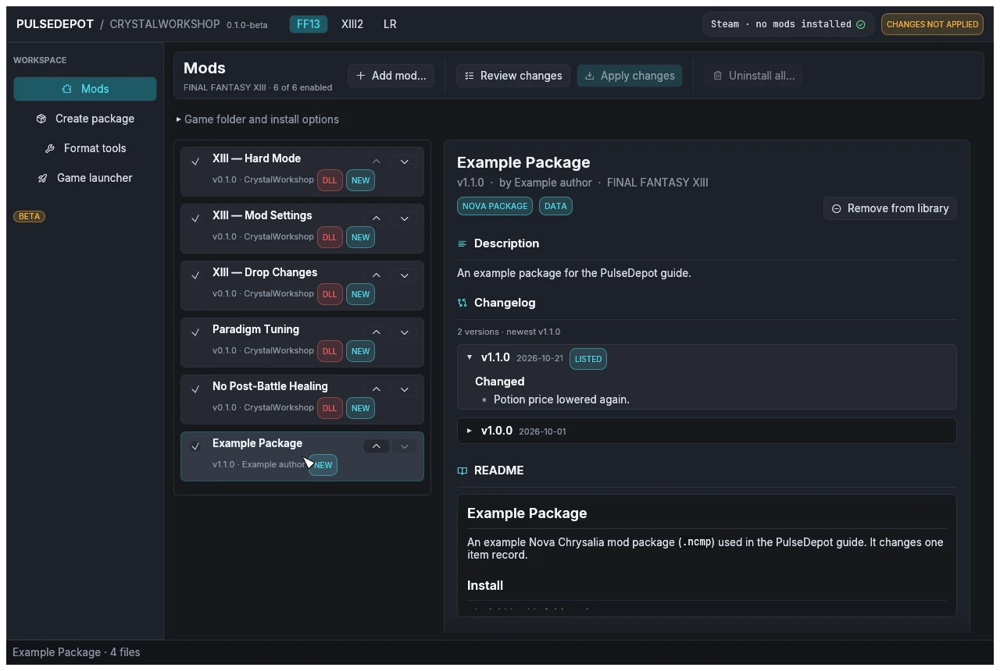

import { Steps } from '@astrojs/starlight/components';

Many older mods for the trilogy were packaged for the **Nova Chrysalia** mod manager. PulseDepot reads those packages directly and merges them like shards. It never runs that mod manager's own installer.

## What a package looks like

A Nova Chrysalia package (`.ncmp`, or the same thing as a `.zip`) holds:

- a `modconfig.ini` with `[ModPackConfig]` (Name, Author, Version, Summary, GameEntry) and `[NovaChysaliaConfig]` flags (DataPatch, ENPatch, JPPatch, CodePatch, ExtPatch);
- folders `Data/`, `EN-Data/`, `JP-Data/`, `Code/*.nccp` or `External/`.

PulseDepot compares the package with your original game files when it reviews.

## Steps

<Steps>

1. **Choose Add mod…** and pick the `.ncmp` or `.zip`, or drop it on the window. It joins the same list as your shards.

2. **Select it to check its details.** A package shows the badge **NOVA PACKAGE**, plus **DATA**, **EN** or **JP** for the folders it ships, its description, changelog (when it has one) and README.

   

   The screenshots on this page use a small example package made for this guide.

3. **Put it in the right place in the load order.** Mods lower in the list win conflicts. See [Order, enable and resolve conflicts](../order-and-conflicts/).

4. **Review and apply** as usual. See [Review and apply](../review-and-apply/).

</Steps>

## Packages with an external setup

Packages that need an **external setup** (`ExtPatch`) cannot join the merged list. The list marks them **SETUP**. Install them alone from their details panel with **External setup (this package only)**. On Linux this runs the package's setup through a Wine executable you choose.

## Script changes in packages

PulseDepot stores the script (`.clb`) changes of a Nova Chrysalia package as byte patches. How script changes from several mods are combined depends on whether a JDK is installed: see [Script mods and Java](../order-and-conflicts/#script-mods-and-java).

Next: [4. Order, enable and resolve conflicts](../order-and-conflicts/).
