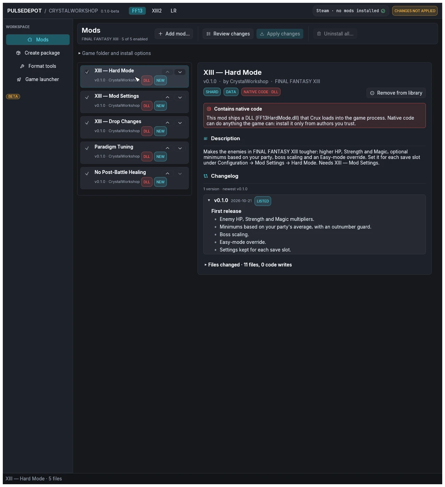

import { Steps } from '@astrojs/starlight/components';

A **CrystalWorkshop Shard** (`.cws`) is a mod built with CrystalWorkshop: its changes are stored as differences from your own game files, plus optional native code. Older shards with the `.bin` extension also load. Every [mod on this site](../../mods/) is a shard.

<Steps>

1. **Download the shard**, for example from [Downloads](../../downloads/#mods). Some mods need others: Hard Mode and Drop Changes need XIII Mod Settings for their in-game menu. Each mod page lists what it needs.

2. **Choose Add mod…** on the Mods page, or drop the files onto the window. PulseDepot copies each file into its own library, so you can move or delete the file you added afterwards.

   Every added mod appears in the list with the badge **NEW**: **Apply changes** will install it.

   

3. **Select a mod to read its details.** The details panel shows:

   - version, author and game;
   - badges: **SHARD** or **NOVA PACKAGE**; **DATA**, **EN**, **JP**; **CODE · Crux**; **NATIVE CODE · DLL**;
   - the description, changelog and README;
   - the files it changes, and any conflicts once you have reviewed.

   

4. **Read the red notice on mods with native code.** A unit (DLL) runs inside the game process and can do anything the game can. Install such mods only from authors you trust. The list marks them with **DLL**.

5. **Continue with [Review and apply](../review-and-apply/).** Nothing is installed until you apply.

</Steps>

:::tip[Adding a mod you already have]
Adding a **newer** version of a listed mod replaces the old one in place. Adding an **older** version asks first. See [Update and remove mods](../update-and-remove/).
:::

Next: [3. Install Nova Chrysalia mods (.ncmp)](../install-ncmp/).
