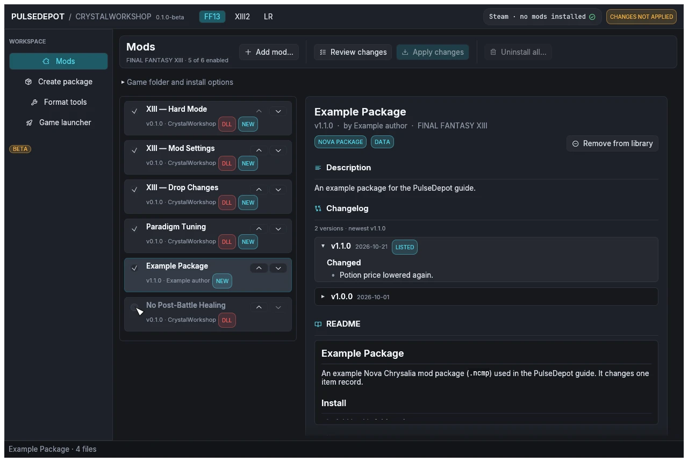
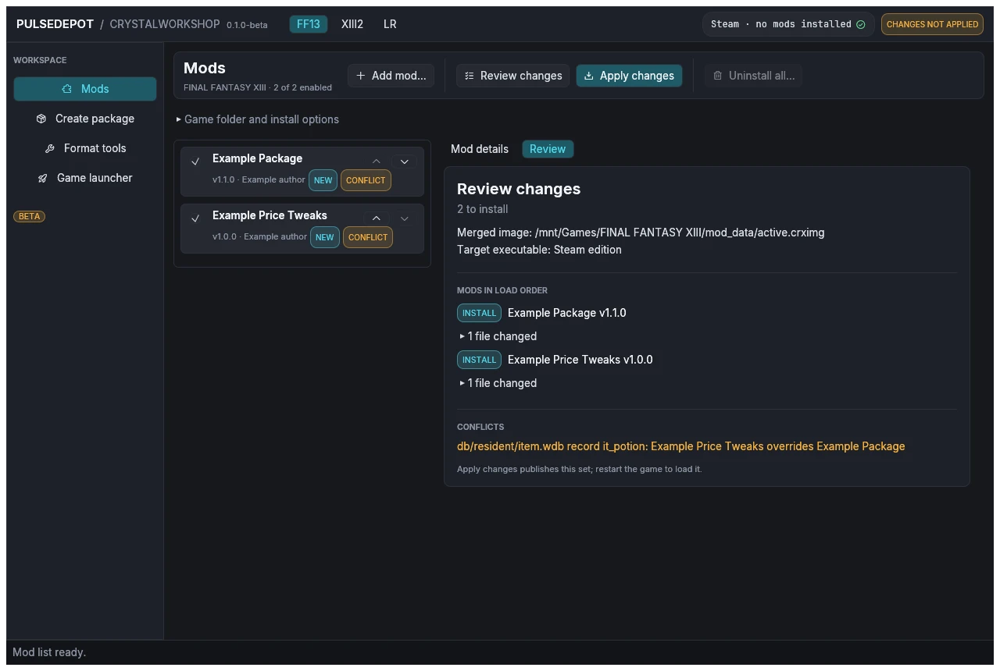

import { Steps } from '@astrojs/starlight/components';

**Goal:** the right mods are enabled, in the right order, and you know who wins each conflict.

<Steps>

1. **Enable or disable a mod** with the checkbox on its row. A disabled mod stays in the list. If it is installed, the next Apply removes it.

2. **Set the order** with ▲ (load earlier) and ▼ (load later). **Later mods win conflicts.** Drag and drop is not supported.

   Here the example package was moved up and Paradigm Tuning was disabled:

   

3. **Review to see the conflicts.** Choose **Review changes**. Mods that change the same thing as another enabled mod get the badge **CONFLICT**, and the review lists each one as "*subject*: *winner* overrides *others*".

   

4. **Decide who should win** and move that mod lower in the list. Then review again.

</Steps>

## Row badges

| Badge | Meaning |
|---|---|
| NEW | Apply installs it. |
| INSTALLED | Already installed. |
| UPDATE | Apply installs a newer version. |
| DOWNGRADE | Apply installs an older version. |
| REMOVE | Installed but disabled; Apply removes it. |
| CONFLICT | Another enabled mod changes the same file. |
| DLL | The mod ships native code. |
| SETUP | The package needs its external setup. |

## How conflicts are resolved

- A file that only one mod changes is used as is.
- Text (`.ztr`), database (`.wdb`) and WPD packs that several mods change are merged **entry by entry** against the original file. The later mod wins each entry both change.
- For any other file type, the whole file comes from the latest mod in the list.
- Game scripts: see below.

## Script mods and Java

A JDK 17 or newer (`java` and `javac`) is needed only for mods that change game scripts. PulseDepot finds Java through `JAVA_HOME`, then `PATH`. `Start-PulseDepot.cmd` / `start-pulsedepot.sh` put `JAVA_HOME`'s JDK first, and `Check-Java` shows what it finds. The Vineflower jar it also needs ships in the package.

- **With a JDK**, script changes from several mods are merged class by class. When two mods change the same lines, the later mod wins, and the review lists it as a conflict.
- **Without a JDK:**
  - A mod whose script changes are stored as Java source (as CrystalWorkshop stores them when its author has a JDK) cannot be applied. **Review changes** stops and asks you to install a JDK 17 or newer.
  - Script changes stored as byte patches still apply, but they are not merged class by class: when two mods change the same script file, the later mod wins that whole file, and the other mod's changes to it are lost. The review shows a warning and lists the conflict.

Next: [5. Review and apply](../review-and-apply/).
