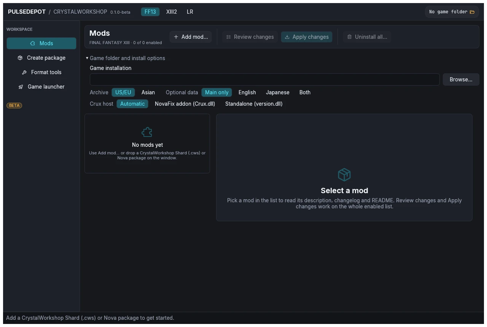
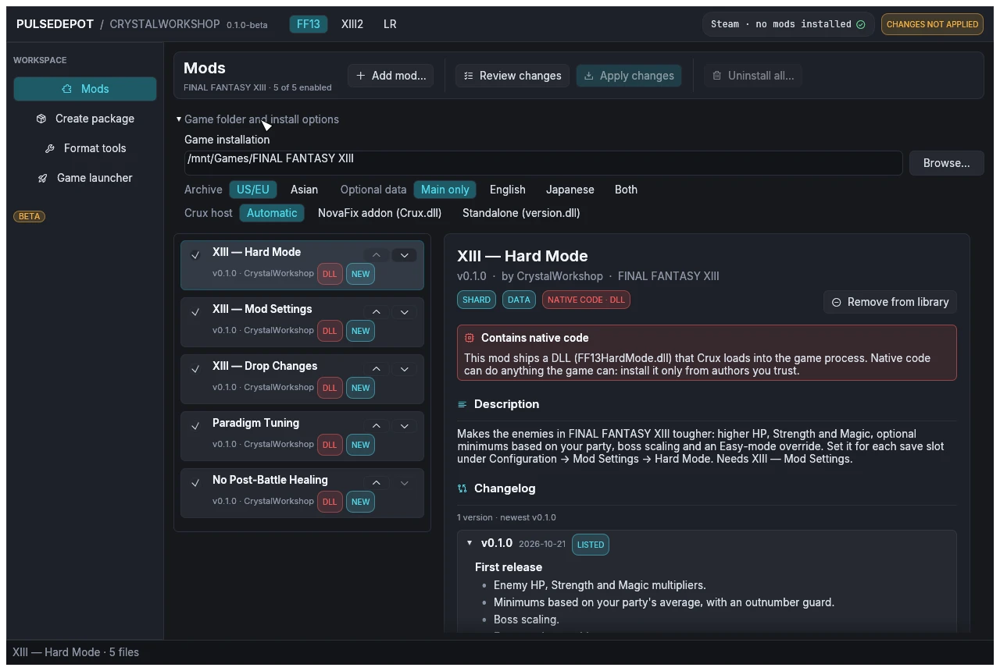
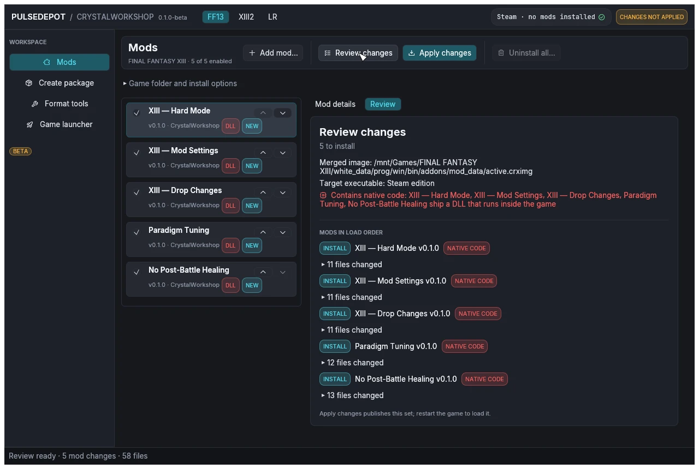
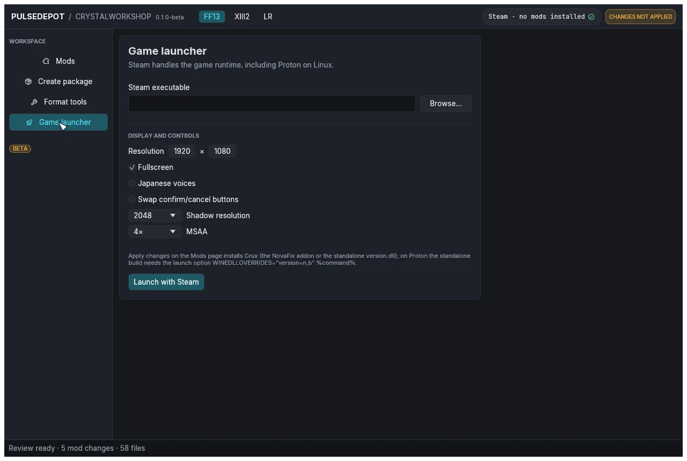
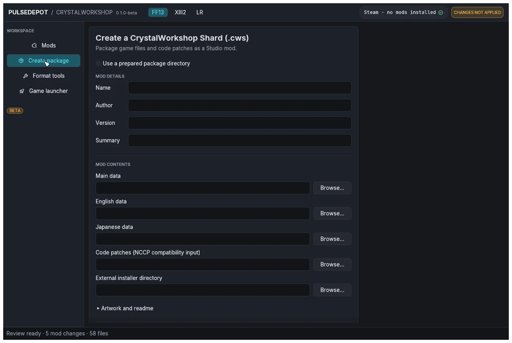
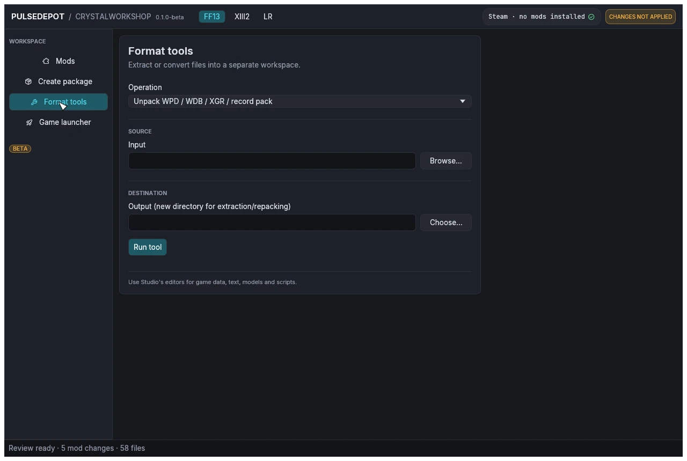
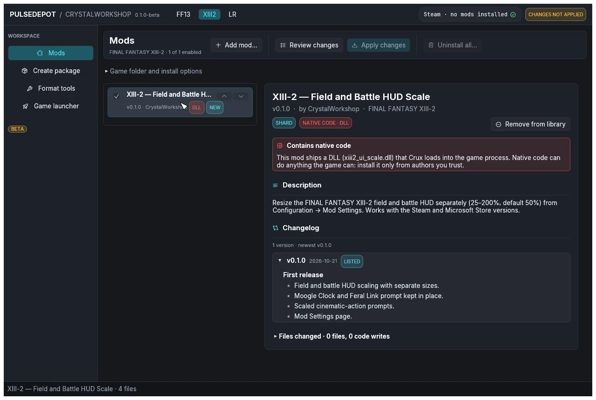

import { Tabs, TabItem, Steps, Aside, Badge, LinkCard, CardGrid } from '@astrojs/starlight/components';

{/* Generated by scripts/generate.mjs from the release docs. Edit the source, then run npm run generate. */}

PulseDepot is the mod manager for the FINAL FANTASY XIII trilogy on PC (Steam).
It installs mods made with CrystalWorkshop and older Nova Chrysalia mod
packages without editing your game archives or your save files.

**Full guide and documentation:
[CrystalWorkshop site](https://hectormiguel1.github.io/crystalworkshop-site/)**
([PulseDepot guides](https://hectormiguel1.github.io/crystalworkshop-site/pulsedepot/),
[Changelog](https://hectormiguel1.github.io/crystalworkshop-site/changelog/),
[Report a problem](https://github.com/hectormiguel1/crystalworkshop-site/issues/new/choose)).

:::caution[BETA]
This is the first public build. It is tested in game and has
passed automated tests on Linux and under Wine, but it has **not** been
tested on a real Windows PC. Mods never change your save files. Report
problems with the files listed under [Troubleshooting](#troubleshooting).
:::


## How it fits together

```
CrystalWorkshop  ──makes──▶  shards (.cws)
PulseDepot       ──merges──▶ every enabled mod into one image: mod_data/active.crximg
Crux             ──loads───▶ that image inside the game (a small DLL PulseDepot installs)
```

- A **shard** (`.cws`) is a CrystalWorkshop mod. It stores the mod's changes
  as differences from *your own* game files, plus optional native code
  ("units") that Crux loads.
- **PulseDepot** keeps your mod list, checks it, and merges every enabled mod
  into one **Crux image**, `active.crximg`.
- **Crux** is the mod host the game loads. It serves the image's files to the
  game while it runs and loads the mods' units. It ships in two builds:
  - `Crux.dll`, a NovaFix addon;
  - `version.dll`, standalone, for games without NovaFix.

  PulseDepot picks the right build and installs it when you apply.

## Contents of the package

| File | What it is |
|---|---|
| `pulsedepot.exe` / `pulsedepot` | PulseDepot (64-bit Windows / x86_64 Linux). |
| `Crux/Crux.dll` | Crux as a NovaFix addon (32-bit, loaded by the game). |
| `Crux/version.dll` | Crux standalone (32-bit). It forwards every Windows `version.dll` call to the system copy. |
| `Crux/CRUX-MANIFEST.json` | Size and SHA-256 of both Crux builds. PulseDepot checks them before it installs one. |
| `Crux/CRUX-BUILD.json` | Build details of both Crux builds. |
| `Crux/Crux.ini.example` | Starting Crux settings for a new setup. |
| `support/ff13-studio/tools/vineflower-1.12.0.jar` | The Vineflower 1.12.0 Java decompiler, used to merge script mods. Nothing to download. |
| `Start-PulseDepot.cmd`, `Check-Java.cmd` (Windows) / `start-pulsedepot.sh`, `check-java.sh` (Linux) | Start PulseDepot with `JAVA_HOME`'s JDK, or show the Java it will use. |
| `README-Windows.txt` / `README-Linux.txt` | A short version of this guide. |
| `docs/` | This guide and its screenshots. |
| `LICENSE`, `THIRD-PARTY-NOTICES.txt`, `licenses/` | The licence and the third-party notices (see [Licences](../../legal/)). |
| `BUILD-INFO.json` | Build details, file hashes, and what was and was not tested. |

## Requirements

- The Steam release of FINAL FANTASY XIII and/or XIII-2. LIGHTNING RETURNS is
  in the game list, but no LR mods ship with this release. Treat LR support
  as experimental.
- **Microsoft Store versions:** only XIII-2, and only as an experiment:
  PulseDepot cannot start Store games yet. See
  [Compatibility](https://hectormiguel1.github.io/crystalworkshop-site/compatibility/).
- **Windows:** 64-bit Windows 10 or 11 with Direct3D 12 or Vulkan drivers.
- **Linux:** x86_64 with a Vulkan or OpenGL driver. The games run through
  Steam Play (Proton).
- **NovaFix is optional.** With NovaFix, Crux runs as its addon. Without it,
  Crux runs as `version.dll` beside the game executable.
- **Mods that change game scripts only:** a 64-bit JDK 17 or newer (`java`
  and `javac`, not just a Java runtime). No Java is bundled. See
  [Script mods and Java](#script-mods-and-java).

## Install on Windows

1. Extract `pulsedepot-0.1.0-beta-windows-x86_64.zip` to a folder you can
   write to, for example `C:\Games\PulseDepot`. Do not use `Program Files`.
   Keep the whole folder together: PulseDepot refuses to apply without `Crux\`.
2. Optional: check the zip against `SHA256SUMS.txt`
   (PowerShell: `Get-FileHash .\pulsedepot-0.1.0-beta-windows-x86_64.zip`).
3. Start `pulsedepot.exe`. The build is **not code-signed**, so SmartScreen
   may say "Windows protected your PC". Choose **More info**, check that the
   file is `pulsedepot.exe` from this folder, then choose **Run anyway**.
4. For script mods, install a JDK 17 or newer, for example the Eclipse
   Temurin JDK 17 (or 21) MSI from adoptium.net with **Set JAVA_HOME
   variable** and **Add to PATH** turned on. Then start PulseDepot with
   `Start-PulseDepot.cmd`, which puts `%JAVA_HOME%\bin` first on `PATH`.
   Run `Check-Java.cmd` to see the versions found.

## Install on Linux (Steam / Proton)

1. Extract `pulsedepot-0.1.0-beta-linux-x86_64.zip` anywhere you can write,
   for example `~/Games/PulseDepot`, with
   `unzip pulsedepot-0.1.0-beta-linux-x86_64.zip` (or any archive manager that
   keeps file permissions). Start `./pulsedepot` or `./start-pulsedepot.sh`.
   If it won't start, run `chmod +x pulsedepot start-pulsedepot.sh check-java.sh`
   in the extracted folder. (No AppImage is built for this release.)
2. PulseDepot finds Steam libraries in these places, reading every library
   listed in each one's `libraryfolders.vdf`:
   - `~/.steam/steam`
   - `~/.steam/root`
   - `~/.local/share/Steam`
   - the Flatpak Steam folder

   `FF13_GAME_DIR`, `FF13_2_GAME_DIR` and `LR_GAME_DIR` override detection.
3. **Standalone Crux (no NovaFix):** set the game's Steam launch options once,
   in Properties > General > Launch options:

   ```
   WINEDLLOVERRIDES="version=n,b" %command%
   ```

   Without this override, Proton uses Wine's own `version.dll` and Crux never
   loads.
4. **With NovaFix** (Crux as `addons/Crux.dll`), keep whatever NovaFix itself
   needs. Crux adds no requirement.
5. For script mods, install a JDK 17 or newer from your distribution, for
   example Arch `jdk17-openjdk` or `jdk21-openjdk`, Debian/Ubuntu
   `openjdk-17-jdk`, Fedora `java-17-openjdk-devel`. Run `./check-java.sh`
   to see the versions found.

PulseDepot writes only into the game folder (see
[What Apply writes](#what-apply-writes)). It never touches the Proton prefix
or your saves.

## First start: choose the game and its folder



- Pick the game with the **FF13 / XIII2 / LR** tabs at the top. Each game
  keeps its own folder, mod list and launcher options.
- If the game was found, the header shows `Steam · no mods installed`.
  Otherwise open **Game folder and install options** and choose
  **Browse…**. Pick the folder that contains `white_data` (XIII),
  `alba_data` (XIII-2) or the LR game files.



| Option | What it does |
|---|---|
| **Archive** | US/EU or Asian archives (LR: English or Japanese voice). Use the one your game runs. |
| **Optional data** | Install a mod's English or Japanese voice/text data as well. |
| **Crux host** | **Automatic** (the default): the NovaFix addon when NovaFix is installed (`d3d9.dll` and `NovaFix.ini` beside the game executable; that `d3d9.dll` is NovaFix's, and PulseDepot never ships or changes it), otherwise standalone `version.dll`. **NovaFix addon (Crux.dll)** and **Standalone (version.dll)** force one build. |

## Adding mods

Use **Add mod…**, or drop files onto the window. PulseDepot copies each file
into its own library, so the file you added can be moved or deleted
afterwards.

| File | What it is |
|---|---|
| **CrystalWorkshop Shard (`.cws`)** | A mod built by CrystalWorkshop: changes stored as differences from your game files, plus optional native code. Older shards with the `.bin` extension also load. |
| **Nova Chrysalia package (`.ncmp`, or `.zip`)** | An older mod package made for the Nova Chrysalia mod manager: a ZIP with a `modconfig.ini` (`[ModPackConfig]` Name / Author / Version / Summary / GameEntry, and `[NovaChysaliaConfig]` DataPatch / ENPatch / JPPatch / CodePatch / ExtPatch flags) and `Data/`, `EN-Data/`, `JP-Data/`, `Code/*.nccp` or `External/` folders. PulseDepot compares the package with your original game files when it reviews, and merges it like a shard. It never runs that mod manager's own installer. |

Packages that need an **external setup** (`ExtPatch`) cannot join the merged
list. Install them alone from their details panel ("External setup (this
package only)"). On Linux this runs the package's setup through a Wine
executable you choose.

Adding a newer version of a listed mod replaces the old one in place.
Adding an **older** version asks first:

- **Downgrade to vX** puts the older file in place. The prompt lists the
  releases it rolls back.
- **Keep vY** keeps what you have.

Adding the same version with different contents asks whether to replace the
listed file.

### Mod details

Select a mod to read its details:

- version, author and game;
- badges:
  - **SHARD** or **NOVA PACKAGE**;
  - **DATA**, **EN**, **JP**;
  - **CODE · Crux**;
  - **NATIVE CODE · DLL**;
- description, changelog and README;
- the files it changes;
- any conflicts.

**A mod that ships native code shows a red notice.** A unit runs inside the
game process and can do anything the game can. Install such mods only
from authors you trust.

## Enabling, ordering and conflicts

- **Enable / disable:** the checkbox on each row. Disabled mods stay in the
  list. If one is installed, Apply removes it.
- **Order:** ▲ loads a mod earlier, ▼ loads it later. **Later mods win
  conflicts.** Drag-and-drop reordering is not supported.
- **Row badges:**

  | Badge | Meaning |
  |---|---|
  | NEW | Apply installs it. |
  | INSTALLED | Already installed. |
  | UPDATE | Apply installs a newer version. |
  | DOWNGRADE | Apply installs an older version. |
  | REMOVE | Installed but disabled; Apply removes it. |
  | CONFLICT | Another enabled mod changes the same file. |
  | DLL | The mod ships native code. |
  | SETUP | The package needs its external setup. |

- **How conflicts are resolved:**
  - A file that only one mod changes is used as is.
  - Text (`.ztr`), database (`.wdb`) and WPD packs that several mods change
    are merged entry by entry against the original file. The later mod wins
    each entry both change.
  - For any other file type, the whole file comes from the latest mod in
    the list.
  - Game scripts: see [Script mods and Java](#script-mods-and-java).
  - The details pane and the review list each conflict as
    "*subject*: *winner* overrides *others*".

### Script mods and Java

A JDK 17 or newer (`java` and `javac`) is needed only for mods that change
game scripts. PulseDepot finds Java through `JAVA_HOME`, then `PATH`
(`Start-PulseDepot.cmd` / `start-pulsedepot.sh` put `JAVA_HOME`'s JDK
first; `Check-Java` shows what it finds). The Vineflower jar it also needs
ships in the package.

- **With a JDK**, script changes from several mods are merged class by
  class. When two mods change the same lines, the later mod wins, and the
  review lists it as a conflict.
- **Without a JDK:**
  - A mod whose script changes are stored as Java source (as CrystalWorkshop
    stores them when its author has a JDK) cannot be applied. **Review
    changes** stops with "Merging script changes needs a JDK 17 or newer
    (javac and java) and the Vineflower jar: a mod in the list changes game
    scripts as Java source, and …. Install a JDK, then review again."
  - Script changes stored as byte patches still apply, but they are not
    merged class by class: when two mods change the same script file, the
    later mod in the load order wins that whole file, and the other mod's
    changes to it are lost. The review shows a warning and lists the
    conflict.
  - PulseDepot stores the script (`.clb`) changes of a Nova Chrysalia
    package as byte patches.

## Review and Apply

1. Choose **Review changes**. PulseDepot builds the merged image from every
   enabled mod and shows what Apply will do. It writes nothing yet.

   

   The review shows:
   - how many mods it will install, update, downgrade, rebuild or remove;
   - where the merged image goes and which game executable it targets;
   - any memory patches and native code;
   - each mod's changed files, the conflicts and any Crystarium merge.
2. Choose **Apply changes**. Close the game first. Apply checks again that
   nothing changed since the review, then installs the set. The status line
   reports, for example:
   - "NovaFix found." or "NovaFix not found.";
   - "Installed Crux as …\\Crux.dll (SHA-256 verified)." or "Crux is up to
     date";
   - "Applied: N mod(s) installed. Restart the game to load the new set."
3. Start the game.

### What Apply writes

- **The merged image** `active.crximg` goes in Crux's mod folder:
  - `modRoot` from `Crux.ini`, if one is set;
  - otherwise `addons/mod_data` beside the game executable, if that folder
    exists;
  - otherwise `<game folder>/mod_data`.
- **PulseDepot's own state** goes in `<game folder>/ff13_studio/nova/<game>/`:
  the installed mod list (`bundle.json`), the installed mods and backups of
  any image PulseDepot did not make.
- **Crux** is installed as one of:
  - `Crux.dll` in the NovaFix `addons` folder. For XIII:
    `white_data\prog\win\bin\addons\`; for XIII-2:
    `alba_data\prog\win\bin\addons\`.
  - `version.dll` beside the game executable. For XIII:
    `white_data\prog\win\bin\`; for XIII-2: `alba_data\prog\win\bin\`; for
    LR: the game folder.

  Installing one build removes the other, so only one Crux runs.
- **Saves are never read or written.** A mod's settings live in Crux's host
  storage (`mod-state.dat` in the mod folder), keyed by save slot.

### When Apply refuses

Apply stops **before writing anything** in these cases:

- **"Crux not installed: … does not match … extract the whole PulseDepot
  zip again."** A Crux DLL beside PulseDepot is missing or altered.
  Extract the package again.
- **"… version.dll belongs to another program (it is not Crux)."** Another
  tool, such as an ASI loader, owns `version.dll`. PulseDepot never
  replaces it. Remove that file yourself, or choose **NovaFix addon
  (Crux.dll)** under **Crux host**.
- **"installed mod set changed since review; review again".** The
  installed set changed since you reviewed. Review again.

## Running the game

- Start the game from Steam as usual, or open **Game launcher** in PulseDepot
  and choose **Launch with Steam**. The launcher runs
  `steam -applaunch <app id>` with the resolution, fullscreen, voice,
  shadow, MSAA and button options shown there. LR has no display options.
  On Windows without a known `steam.exe`, PulseDepot opens a
  `steam://rungameid` link instead, and these options do not apply.

  

- Restart the game after every Apply.
- With the standalone Crux under Proton, keep
  `WINEDLLOVERRIDES="version=n,b" %command%` in the launch options.

## Other pages

- **Create package** builds a CrystalWorkshop Shard from a folder of changed
  files: Nova Chrysalia-style `Data/`, `EN-Data/`, `JP-Data/`, NCCP code patches, or
  an external installer, plus metadata and artwork. It compares the folder
  with your own game files, so it needs the game folder. Most authors
  should build shards in CrystalWorkshop instead.

  

- **Format tools** extracts or converts single files into a separate
  workspace and never writes into the game. It handles:
  - WPD / WDB / XGR / record packs;
  - ZTR ↔ JSON or Nova TXT;
  - filelists;
  - White archives;
  - TRB/IMGB;
  - SCD ↔ Ogg/WAV;
  - WDB ↔ `.xlsx` or SQLite.

  

- **The XIII2 tab** keeps its own list. The example below shows the XIII-2
  UI Scale shard.

  

## Uninstalling

- **One mod:** untick it (or choose **Remove from library**), then
  **Review changes** and **Apply changes**.
- **Every mod:** choose **Uninstall all…**, then **Apply changes**. This
  removes `active.crximg` and keeps your list, so you can apply it again
  later.
- **Crux itself:** PulseDepot does not remove Crux. After uninstalling the
  mods, delete `addons\Crux.dll`, or the `version.dll` beside the game
  executable, by hand. Then remove the `WINEDLLOVERRIDES` launch option on
  Linux.
- **All PulseDepot state:** delete `<game folder>\ff13_studio\nova\` (or the
  whole `ff13_studio` folder if you do not use CrystalWorkshop) and the
  `active.crximg` that Apply wrote.
- **PulseDepot itself:** delete its folder. It installs nothing else.

**Your saves are untouched** at every step. PulseDepot and Crux never read or
write save files.

## Troubleshooting

| Problem | What to do |
|---|---|
| SmartScreen blocks the start | The build is not signed. Choose **More info**, then **Run anyway** (see [Install on Windows](#install-on-windows)). |
| The window closes at start with a graphics (wgpu) error | Start PulseDepot from a terminal with `WGPU_BACKEND=vulkan` (or `gl`) set. |
| Mods do not show up in game | Check that `Crux.jsonl` exists in the `addons` folder beside the game executable (both builds log there). **No log** means Crux did not load: check the launch option on Proton (standalone build) or the NovaFix install (addon build). **A log** means it loaded: read the last lines for errors. |
| "Crux not installed: …" | See [When Apply refuses](#when-apply-refuses). |
| Apply says a file could not be written | Close the game and apply again. |
| Review stops: "Merging script changes needs a JDK 17 or newer …", or warns that the later mod wins a script file | Install a 64-bit JDK 17+ (see [Script mods and Java](#script-mods-and-java)) and start PulseDepot with `Start-PulseDepot.cmd` / `start-pulsedepot.sh`. `Check-Java` shows what is found. Then review again. |

**Crux log:**
- The file is `Crux.jsonl` in the Crux folder (`addons`). It rotates to
  `Crux.jsonl.1` and `Crux.jsonl.2`.
- Logging is set by `[log] mode` in `Crux.ini`: `2` (the default) writes the
  file, `1` shows a console, `3` does both.
- Attach this log to bug reports, together with PulseDepot's status line and
  `BUILD-INFO.json`.

## Known issues (BETA)

- Not code-signed and no installer.
- Not yet tested on a real Windows PC. It was checked on Linux and under
  Wine.
- The Linux build is a native x86_64 binary and is not packaged as an
  AppImage. Its runtime has been tested less than the Windows build's.
- PulseDepot never removes Crux itself (see [Uninstalling](#uninstalling)).
- LIGHTNING RETURNS appears in the game list, but no LR mod ships with this
  release.
- Only the ▲/▼ buttons reorder the list.
