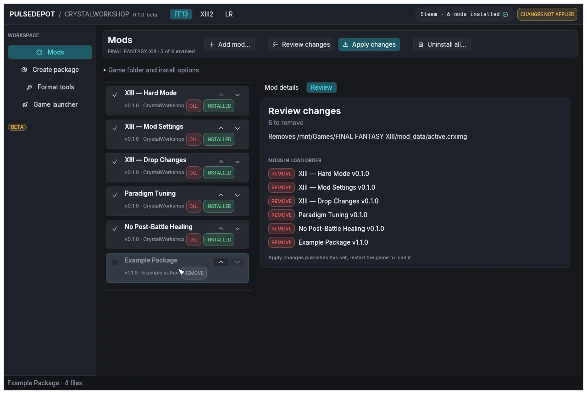

import { Steps } from '@astrojs/starlight/components';

:::note[Your saves are untouched]
PulseDepot and Crux never read or write save files, at any step below.
:::

<Steps>

1. **Remove every mod.** Choose **Uninstall all…**. PulseDepot reviews removing every installed mod; then choose **Apply changes**. This removes `active.crximg` and keeps your list, so you can apply it again later.

   

   To remove a single mod instead, see [Update and remove mods](../update-and-remove/#remove-a-mod).

2. **Remove Crux, if you want to.** PulseDepot does not remove Crux. After uninstalling the mods, delete it by hand:

   - the addon: `Crux.dll` in the NovaFix `addons` folder;
   - the standalone build: the `version.dll` beside the game executable.

   On Linux, also remove `WINEDLLOVERRIDES="version=n,b" %command%` from the game's launch options. See [Uninstall Crux](../../crux/uninstall/).

3. **Remove PulseDepot's state, if you want to.** Delete `<game folder>\ff13_studio\nova\`, or the whole `ff13_studio` folder if you do not use CrystalWorkshop, and the `active.crximg` that Apply wrote.

4. **Remove PulseDepot itself.** Delete its folder. It installs nothing else.

</Steps>
