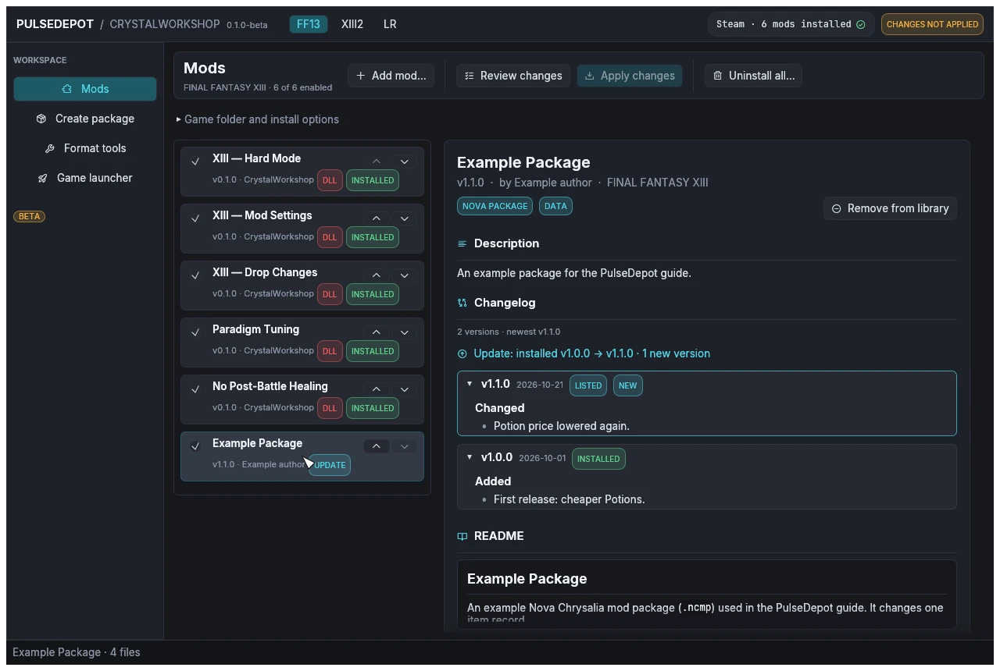
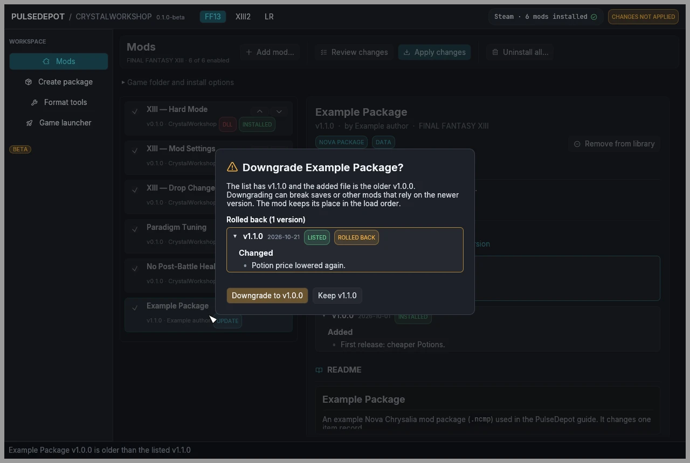
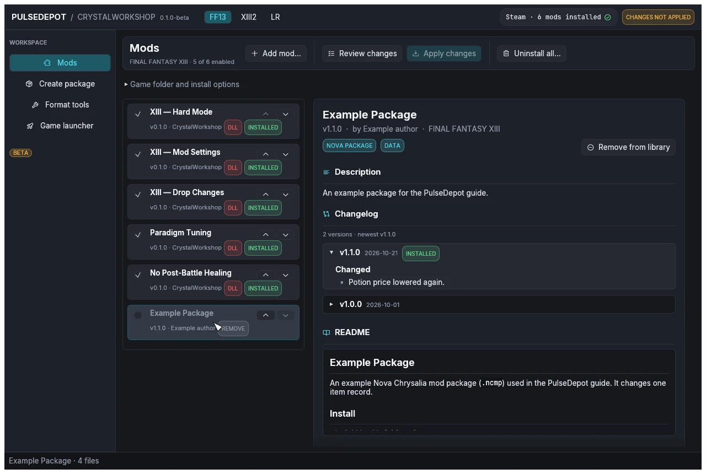

import { Steps } from '@astrojs/starlight/components';

PulseDepot compares your list with what is installed, so every change shows up as a badge before you apply. The screenshots use example packages made for this guide.

## Update a mod

<Steps>

1. **Add the newer file** with **Add mod…** (or drop it on the window). It replaces the listed version in place and keeps its position in the load order.

2. **Read what is new.** The row shows **UPDATE**, and the changelog in the details panel labels the installed and the new versions, with the new releases highlighted.

   

3. **Review changes, then Apply changes**, with the game closed. Restart the game.

</Steps>

## Roll back to an older version

<Steps>

1. **Add the older file.** PulseDepot asks first, and lists the releases the downgrade rolls back.

   

2. **Choose Downgrade to vX** to put the older file in place, or **Keep vY** to keep what you have. The row then shows **DOWNGRADE** until you apply.

3. **Review and apply.** Downgrading can break saves or other mods that rely on the newer version: read the rolled-back changes before you confirm.

</Steps>

Adding the same version with different contents asks whether to replace the listed file.

## Remove a mod

<Steps>

1. **Untick the mod** to keep it in your list but uninstall it, or **select it and choose Remove from library** to drop it from the list too. An installed mod that is disabled shows **REMOVE**.

   

2. **Review changes, then Apply changes.** Restart the game.

</Steps>

Your saves are never changed. Mods keep their settings in Crux's own storage (`mod-state.dat`), not in your saves; the mods on this site get their settings back if you install them again.

Next: [8. Uninstall](../uninstall/).
